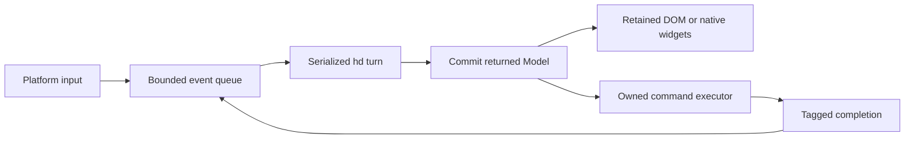

# GUI Applications

**Parked by the owner on 2026-10-24: not worth doing now, and the owner thinks the recommended direction (an Elm-style message/model/view package) is somehow wrong.** Keep this as the exploration of the domain only: any future GUI work starts from a fresh direction discussion, not from this recommendation.

Design exploration, 2026-10-24; domains: application framework, runtime and host; nothing here is accepted behavior.
This answers [#807](https://github.com/HerringtonDarkholme/hd-lang/issues/807), following [#58's exploration-first instruction](https://github.com/HerringtonDarkholme/hd-lang/issues/58#issuecomment-6376850875).
It teaches the domain, compares four mechanisms, and recommends a placement and initial model for owner review.
It implements no GUI framework, compiler feature, standard-library API, or embedding SDK.

## Contents

- [The Domain](#the-domain)
- [Problem And What hd Has Today](#problem-and-what-hd-has-today)
- [Survey](#survey)
- [Option A: Host UI With hd Domain Logic](#option-a-host-ui-with-hd-domain-logic)
- [Option B: Messages, Model And Retained Views](#option-b-messages-model-and-retained-views)
- [Option C: Explicit Signals And Subscriptions](#option-c-explicit-signals-and-subscriptions)
- [Option D: Immediate Frames](#option-d-immediate-frames)
- [Comparison](#comparison)
- [State, Ownership And Suspension](#state-ownership-and-suspension)
- [Host Integration And Event Loop](#host-integration-and-event-loop)
- [Rendering And Layout](#rendering-and-layout)
- [Recommended Boundary And Delivery Outline](#recommended-boundary-and-delivery-outline)
- [Costs And Evidence](#costs-and-evidence)
- [Stress Cases](#stress-cases)
- [Recommendation](#recommendation)
- [Sources And Parse Log](#sources-and-parse-log)
- [Questions For The Owner](#questions-for-the-owner)

## The Domain

A GUI is a long-lived conversation between application state, user input, background work, and a platform renderer.
A counter is easy because those pieces fit in one event.
A form or search list exposes what happens while work is pending, identities move, or a window disappears.
The hard question is who owns each lifetime, rather than how to spell a button.

| Term | Meaning | Common mistake |
| --- | --- | --- |
| Model | Application values, such as a draft name or selected result. | Treat a widget's current pixels as the only source of truth. |
| View | A description of what should be shown. | Perform network work whenever a view is recomputed. |
| Retained renderer | Keeps platform widgets or nodes between updates. | Assume rebuilding a description should recreate text fields and lose selection. |
| Immediate mode | Re-describes widgets during a frame, usually with explicit application state. | Assume no state persists inside the toolkit or no stable identities are needed. |
| Signal | An observable cell whose supported writes notify subscribers. | Expect every write through an ordinary mutable reference to notify the framework. |
| Reconciliation | Matches new descriptions to existing nodes and updates them. | Use an array position as the identity of a reorderable row. |
| Command | Data describing work to execute after an application update. | Treat describing a command as authority to execute arbitrary host operations. |
| Owner or scope | The lifetime of a window, component, subscription or job. | Let callbacks or replies outlive their owner without validation. |
| Layout | Resolves constraints into geometry before painting. | Treat drawing rectangles as a complete text, editing and accessibility system. |

These mechanisms overlap.
A retained DOM can be driven by messages, signals, or component rerendering.
An immediate-mode library still retains focus and interaction state between frames.
Choosing an update model does not choose a renderer automatically.

### Worked Example: A Search Reply Arrives Late

The user enters `a`, starting request 1, then enters `ab`, starting request 2.
Request 2 finishes first and supplies the desired rows.
Request 1 may already have queued its completion when cancellation arrives.
Accepting that older reply would replace the user's current result with stale data.

The model therefore records a mount generation and the latest request identity.
A reply changes state only if both still match, and the owner is mounted.
Closing the window invalidates its generation and cancels its remaining jobs.
Cancellation saves work; identity validation supplies correctness even when cancellation arrives too late.

The same distinction handles a callback retained after unmount or a replacement compiler worker.
A pointer remaining memory-safe is not permission to update a dead view.
The protocol needs explicit lifetime checks even with reference counting and cycle collection.

## Problem And What hd Has Today

The intended users write application logic in hd and need a clear place for views, state and background work.
The initial consumers are browser tools such as the playground, with desktop and mobile as later targets.
That ordering is a recommendation below, not an owner decision.
Every option is compared on the same cases.

| Case | End-to-end requirement |
| --- | --- |
| U1: counter | Mount at zero, process two clicks, show two, and preserve unrelated editing state. |
| U2: validation form | Edit a name, display a linked error for empty input, accept Ada, and preserve composition/focus during updates. |
| U3: network list | Start searches a/ab, accept request 2, ignore request 1, keep row identity on reorder, and stop updating after unmount. |
| U4: lifetime and scheduling | Cancel pending work on unmount, release subscriptions, and keep the platform UI responsive during slow guest work. |

The [language](../../spec/lang/13-values-and-references.md) already has values, shared references and ordinary closures.
[Scheduling](../../spec/lang/11-requirements-and-suspension.md#cooperative-scheduling) and [task combinators](../../spec/std/task.md) provide cooperative suspension and cancellation.
[Registration](../../spec/lang/10-modules.md#registration) and [boundary-safe values](../../spec/lang/10-modules.md#boundary-safe-values) describe host-callable entries and structural data.
None defines a widget tree, observable field write, DOM callback, native window, or GUI entry convention.

The [playground](../../website/playground/src/main.ts) is currently a TypeScript UI.
It sends compile/run requests to [workers](../../website/playground/src/compiler-client.ts), rather than running its view logic as hd components.
The browser [host](../../host/web.mjs) binds selected capabilities but no GUI provider or event source.
Its current HTTP path uses synchronous XMLHttpRequest inside the run worker.

The [host embedding note](HOST_EMBEDDING.md) proposes explicit entry registration, typed calls and generated adapters.
That SDK is not implemented or approved by this GUI note.
The registration semantics are existing rules, while adapter availability remains delivery work.
The four options can be explored without deciding a new language feature.

### Two Concrete Current Gaps

`std.ui` does not exist; this intentional probe reports `unknown-module: no module named 'std.ui'`, with backticks in the actual diagnostic.

```text
use std.ui.Ui
pub fn main() -> void: pass
```

Visibility also does not expose a function as a host entry.
This complete program builds, but its 392-byte module exports only `hd.init`, `hd.poll`, and exchange memory `hd.x`.
There is no callable `increment` export or generated UI catalogue.

```text
pub fn increment(count: usize) -> usize: count + 1
pub fn main() -> void: pass
```

A proposed `ui.mount` cannot skip that missing registration/invocation work.
No option below treats `pub` as an implicit export, passes a raw closure through the boundary, or silently introduces a new runtime profile.

## Survey

These are mechanisms to borrow, not promises to clone each framework's platform coverage.
The table and notes separate state observation, rendering, and host integration.

| Framework | State/update mechanism | Rendering and placement | Limit relevant to hd |
| --- | --- | --- | --- |
| [React](https://react.dev/learn/state-as-a-snapshot) | State snapshots; setters schedule component rendering. | Library reconciles descriptions into retained host nodes. | A captured snapshot is not a live shared reference; state identity depends on tree position and keys. |
| [Solid](https://docs.solidjs.com/advanced-concepts/fine-grained-reactivity) | Signals and dynamically tracked synchronous reads. | Fine-grained effects update DOM targets. | Ordinary mutation or reads outside a tracked computation do not acquire dependencies automatically. |
| [Elm](https://guide.elm-lang.org/architecture/) | Model, messages, update and commands. | Browser runtime drives rendering and effects. | The command/effect runtime is real infrastructure, not merely a reducer signature. |
| [SwiftUI](https://developer.apple.com/documentation/SwiftUI/Managing-model-data-in-your-app) | Observation records model-property dependencies read by a view. | Apple platform framework owns view and platform integration. | Observation uses generated machinery; plain hd field access has no equivalent tracking rule. |
| [Jetpack Compose](https://developer.android.com/develop/ui/compose/state) | Observable State triggers recomposition; remembered values retain local state. | Compiler-assisted framework integrated with platform UI. | Nonobservable mutable lists can change without recomposition; persistence is separate from remember. |
| [Flutter](https://docs.flutter.dev/resources/architectural-overview) | Rebuilds immutable widget descriptions around retained element/state objects. | Framework, rendering tree, layout engine and platform embedder. | Portable painting requires substantial editing, semantics and platform integration too. |
| [Dioxus](https://dioxuslabs.com/learn/0.7/essentials/basics/signals/) | Signal handles drive reactive component scopes. | Virtual DOM emits mutations to renderers. | Copying a signal handle shares storage; copying its contained value is a different operation. |
| [Leptos](https://book.leptos.dev/reactivity/14_create_effect.html) | Signals notify tracked effects; resources connect async results. | Rust/Wasm library updates DOM targets. | Effects synchronize an external world; async work and disposal need an owner. |
| [egui](https://docs.rs/egui/latest/egui/) | Application supplies persistent values during immediate frames. | Toolkit handles interaction, geometry and painting. | IDs and retained interaction memory still matter; multi-pass layout may invoke UI construction again. |

### React And Solid: Two Different Kinds Of Reactivity

React's snapshot model makes an event handler read the values of its render.
An update schedules a later render; mutating a local variable does not replace framework state.
Its [identity guidance](https://react.dev/learn/preserving-and-resetting-state) explains why changing a key can reset a subtree.
hd can reproduce explicit state replacement, but should not confuse snapshots with its nonexclusive references.

Solid's signal getter records a dependency while a tracked computation is active.
The setter notifies subscribers; targeted updates avoid rebuilding unrelated parts of a component tree.
Its [effect contract](https://docs.solidjs.com/concepts/effects) distinguishes reactive computations from ordinary event handlers.
A library can provide explicit hd getters/setters; automatically tracking all field reads/writes would require a different mechanism.

### Elm: Separate State Transitions From Work

Elm's update consumes a message and model, returning a new model and commands.
Its [HTTP example](https://guide.elm-lang.org/effects/http) returns an HTTP command and later receives a typed completion message.
This makes request identity, tests and cancellation ownership visible.
It does not remove renderer, event queue, command executor or platform responsibilities from the framework.

The useful part for hd is that messages and descriptions are ordinary structural values.
They can cross the current boundary model without exporting closures or shared guest references.
The cost is explicit messages and copied state at an initial stateless entry boundary.

### SwiftUI And Compose: Observation Has Machinery

SwiftUI's Observation tracks model properties read by a view body.
Its observable macro supplies behavior beyond an ordinary field assignment.
That integrates well with Apple controls but is not a library-independent layout or host protocol.
Borrow the separation between model ownership and view dependencies, without assuming hd needs an Observable intrinsic.

Compose connects observable state to recomposition and uses remembered values for local lifetime.
Its documentation explicitly warns that mutable collections without observation can leave the UI stale.
Remembered state is also distinct from saved state across platform recreation.
An hd framework needs explicit observation and persistence contracts too; reference counting supplies neither.

### Flutter: A Cross-Platform Renderer Is A Large Subsystem

Flutter separates widgets, retained elements and render objects, then integrates through platform embedders.
Its layout propagates constraints downward and sizes upward before painting.
This supports rich portable UI but carries a rendering and platform stack far beyond a button constructor.
For an initial hd browser target, DOM layout and native editing avoid owning that entire stack.

### Dioxus And Leptos: Rust Does Not Require A New UI Language

Dioxus combines signals, component scopes and a [VirtualDom](https://docs.rs/dioxus-core/latest/dioxus_core/struct.VirtualDom.html).
Its event-loop API progresses events and produces renderer mutations; rendering is an integration boundary.
The transferable idea is a framework package with ordinary state handles and explicit renderer ownership.
Its RSX surface and Rust-specific tooling do not establish a need for new hd syntax.

Leptos effects track signal dependencies and update the external DOM.
Its [resources](https://book.leptos.dev/async/10_resources.html) relate async work to reactive inputs.
An hd equivalent must define when old requests stop, when subscriptions dispose, and which late results are still eligible.
The signal graph is not itself a capability grant or an async scheduler.

### egui: Immediate Does Not Mean Stateless

egui receives application values each frame and returns interaction responses.
The toolkit retains interaction memory and uses widget identity across frames.
Its documentation also supports multiple layout passes before one visible frame.
Network work therefore belongs to an acknowledged input transition, not to every invocation of a frame-building function.

The main lessons are explicit observation, stable identity, and separate platform ownership.
No surveyed mechanism turns memory safety into lifetime correctness automatically.
A package can supply the update model; host integration still needs a real contract and tests.

## Option A: Host UI With hd Domain Logic

This is the radical simplification: keep React, native controls, or another existing frontend as the UI.
hd supplies domain transitions, validation, typed results and command descriptions.
The frontend owns widget identity, focus, layout, accessibility and the event loop.
No hd widget language or rendering framework is required.

The executable [host-ui model](gui/host-ui.hd) exposes only the domain transition:

```text
fn domain(model: Model, message: Msg) -> (Model, List[Command]):
    update(model, message)
```

For U1, the host button sends Increment and commits the returned count before rendering its own counter.
Two queued events see successive committed states and produce two.
For U2, the host text field keeps its editor state, sends text values to hd, and displays the returned validation error.
It links the error through its own platform semantics.

For U3, the host executes Search commands, tags completions, and applies the returned model to its own keyed list.
The common reducer ignores an older request and all replies after unmount.
For U4, the host owns job cancellation and subscription cleanup; hd holds no widget callbacks.
A browser still needs the embedding bridge; a native application could instead use a process/data protocol.

This loses hd-written views and requires frontend work for each platform.
It is the smallest credible application story, and a useful boundary test before building option B.
It adds ordinary application/library code, with no syntax, intrinsic or language semantic exception.

## Option B: Messages, Model And Retained Views

A separate hd framework package adds a view description and one serialized update path.
The initial public concept is `turn(model, message) -> Turn`, where Turn carries the next model, view and commands.
A host adapter owns the retained DOM or native widgets.
The [messages prototype](gui/messages.hd) implements this ordinary hd core:

```text
struct Turn:
    model: Model
    widgets: List[Widget]
    commands: List[Command]
fn turn(model: Model, message: Msg) -> Turn:
    next := update(model, message)
    Turn { model: next._0, widgets: view(next._0), commands: next._1 }
```

For U1, Increment changes the model; view describes counter text and a button with stable keys.
The host updates the existing text node after committing the turn.
For U2, NameEdited updates text and validation data; the renderer preserves the input object and its editing session.
An error is a semantic field relationship, not only a red color.

For U3, Search returns a command carrying mount/request identity.
The executor returns a Reply message; update accepts only the latest eligible reply, then view describes keyed rows.
Unmount invalidates that owner, releases its platform nodes, and cancels its pending command jobs.
The renderer must discard any queued packet for the previous mount.

The first bridge can pass Model as structural data on each call, rather than inventing a persistent guest-object handle.
The host stores the last committed model; serialization therefore costs proportional to model and view data per turn.
Command execution happens after commit and never inside view recomputation.
Later state residency optimizations need their own measured contract, not a raw RC pointer hidden in the SDK.

This model makes event order and asynchronous outcomes easy to inspect and test.
It adds message boilerplate and a renderer/protocol library, while using existing functions, enums, generics and rows.
There is no new language rule, decorator, compiler-known widget or standard-library requirement.

## Option C: Explicit Signals And Subscriptions

A framework package stores observable cells and owns a dependency/subscription graph.
Rendering reads through supported accessors; setters mark dependent work dirty for a later commit.
Ordinary references still mean ordinary references, so bypassing a setter cannot be promised to notify the graph.
The [signals prototype](gui/signals.hd) demonstrates shared signal handles and explicit version notification:

```text
struct Cell[T]:
    value: T
    version: usize
struct Signal[T]:
    cell: &mut Cell[T]
impl[T] Signal[T]:
    fn read(self) -> T: self.cell.value
    fn write(self, value: T) -> void:
        self.cell.value = value
        self.cell.version += 1
struct Observer:
    seen: usize
    active: bool = true
fn refresh(signal: Signal[Model], observer: &mut Observer) -> List[Widget]:
    if !observer.active || observer.seen == signal.cell.version: return []
    observer.seen = signal.cell.version
    view(signal.read())
```

This is a minimal version/observer model with one coarse Model signal, not a complete fine-grained reactive engine.
A production graph would record reads, replace dynamic dependency sets, batch writes, and dispose nodes with their owners.
Splitting model fields into signals can avoid unrelated recomputation, but that optimization is not measured by this prototype.
The distinction between stored value and shared signal handle is exercised on today's compiler.

For U1, a click setter changes the count signal and queues its text observer.
For U2, text and validation use explicit observable state; the host editor still owns selection and composition.
For U3, a resource owner starts a tagged request and writes accepted results through a setter.
Late results need the same generation check as option B; reactivity does not make cancellation instantaneous.

For U4, unmount disposes subscriptions and cancels owned jobs.
Subscribers should not run inline during setter mutation or call reentrantly into Wasm.
A signal notification cycle needs a defined framework failure or bounded scheduling policy.
Asynchronous reads outside a tracked synchronous computation do not silently acquire dependencies.

This can remain an ordinary library if reads/writes go through its APIs and graph context is explicit or library-managed.
Automatic tracking of every hd field or collection mutation is a separate, more expensive semantic mechanism and is not proposed.
It has more graph, lifetime and debugging machinery than B, with possible later benefits for large reactive views.

## Option D: Immediate Frames

The application supplies state and rebuilds a widget/frame description when input or invalidation requires it.
A toolkit owns hit testing, focus, retained interaction memory, layout and painting.
It is attractive for tools, visual editors and drawing-oriented interfaces.
It is not inherently a universal native-control abstraction.

The [frames model](gui/frames.hd) ensures an input serial is consumed only once, including a repeated layout pass:

```text
struct FrameState:
    model: Model
    consumed: usize = 0
struct Frame:
    state: FrameState
    widgets: List[Widget]
    commands: List[Command]
fn frame(state: FrameState, serial: usize, message: Msg) -> Frame:
    if serial <= state.consumed:
        return Frame { state: state, widgets: view(state.model), commands: [] }
    next := update(state.model, message)
    Frame { state: FrameState { model: next._0, consumed: serial }, widgets: view(next._0), commands: next._1 }
```

For U1, a click edge increments state and requests another frame; a repeated pass does not increment again.
For U2, the toolkit maintains the active editor and presents its current text to validation.
For U3, a committed input emits a command once, accepted replies change application state, and a new frame presents keyed rows.
Placing Search execution in frame construction would duplicate work during repeated passes.

For U4, the frame/window owner cancels jobs and releases toolkit state on close.
Idle windows need not redraw continuously; a host invalidation or wake can request a frame.
A browser canvas renderer would still need text input, accessibility, clipboard, focus and IME integration.
A native toolkit adapter supplies those facilities only if its contract actually includes them.

The model needs no new syntax or compiler intrinsic.
Compared with B, it moves more responsibility to frame identity, event consumption and the selected toolkit.
A production frame engine and renderer are absent from the small executable model.

## Comparison

| Criterion | A: host UI | B: messages and views | C: signals | D: immediate frames |
| --- | --- | --- | --- | --- |
| U1 counter | Host widget plus domain transition. | Explicit Increment, update, keyed view. | Setter plus dirty observer. | Click edge plus one committed frame input. |
| U2 validation | Existing platform form plus hd validation. | Explicit text/error model; renderer preserves editor. | Observable text and derived validation. | Toolkit editor state plus validation per committed input. |
| U3 network list | Host command executor and keyed frontend list. | Tagged command/reply messages and row keys. | Tagged resource lifetime and setters. | Tagged jobs, redraw invalidation and stable widget IDs. |
| U4 lifetime | Host framework owns cleanup. | Mount owns queue, renderer and commands. | Owner additionally owns graph nodes/subscriptions. | Window owns frame memory and jobs. |
| State transport initially | Domain Model crosses structural boundary. | Model and view cross per turn. | Cells remain guest-side; only data/patches cross. | Frame input/descriptions cross; guest state needs explicit residency. |
| Soundness condition | Checked values, grants and serialized state commits. | Same, plus no effects during view construction. | Same, plus mediated writes and graph disposal. | Same, plus acknowledged input serials and no effect duplication. |
| Agent writing | Familiar hd domain functions; another frontend language. | Explicit messages and inspectable data flow. | Short setters; hidden dependency/lifetime mistakes are easier. | Straight-line UI code; render side effects are tempting. |
| Human reading | Two application layers. | One visible update path and command list. | Must follow dependency graph and owner scopes. | Must distinguish input consumption from repeated frame execution. |
| New language rules / IDs | 0 | 0 | 0 with explicit accessors | 0 |
| Most expensive mechanism | Ordinary package/application code. | Package plus renderer/embedding adapters. | Package graph plus renderer/embedding adapters. | Toolkit/frame engine plus embedding adapters. |
| Main implementation cost | Domain bridge and host frontend integration. | View protocol, retained reconciliation and command lifecycle. | Dependency tracking, batching, disposal, diagnostics. | Input, layout, paint, editor and accessibility integration. |
| Evolution | Add hd views later without changing domain events. | Add local reactive leaves behind the boundary later. | More dynamic graph behavior needs careful debugging tools. | Specialized graphics and tooling can grow independently. |

All options need the host to process events without reentrant calls into the same Wasm instance.
No table entry claims an implemented GUI SDK or renderer today.
B's initial structural state transport is deliberately explicit about its copying cost.
C/D need a persistent root or session API rather than exporting internal references as state handles.

## State, Ownership And Suspension

### Values And Shared References Are Different Tools

A model value is copied according to the existing value rules.
A reference copy shares the same place, and [a mutable reference is not exclusive](../../spec/lang/13-values-and-references.md#r-ref.write.no-exclusivity).
The following control prints `copy=0 reference=2` on both engines.

```text
struct Counter:
    count: usize
pub fn main() -> void $ Console:
    let mut first = Counter { count: 0 }
    copied := first
    shared := &mut first
    alias := shared
    alias.count = 2
    if copied.count != 0 || shared.count != 2:
        panic("value copy and shared reference were confused")
    println("copy=${copied.count} reference=${shared.count}")
```

A signal must therefore store a shared cell explicitly; copying its contents must not be mistaken for sharing the observable location.
Mutating an ordinary List or struct is not an automatic signal notification.
The framework needs supported setters or a separate owner-mediated store API.
No Observable or Compose-style compiler transformation is assumed.

### Suspension Can Lose Logical Updates

Single-threaded execution does not make read/await/write atomic.
This deliberately stale-snapshot control prints `interleaved=1`, despite starting two increments.
It is evidence of the existing interleaving model, not a compiler defect.

```text
use std.task.all
use std.time.{Clock, ms, sleep}
struct Counter:
    count: usize
fn late_increment!(state: &mut Counter) -> void $ Clock:
    snapshot := state.count
    sleep!(ms(1))
    state.count = snapshot + 1
pub fn main!() -> void $ Console + Clock:
    let mut state = Counter { count: 0 }
    _ := all!(late_increment(&mut state), late_increment(&mut state))
    if state.count != 1: panic("interleaving control did not expose the stale snapshot")
    println("interleaved=${state.count}")
```

The recommended model commits ordinary update turns serially and runs asynchronous work outside those turns.
A completion returns data for a later update; it does not retain a mutable Model reference across suspension.
Options C and D need an equivalent owner/transaction discipline.
Memory safety alone would allow both aliases in the control.

An empty requirement row is not a proof of referential transparency.
An ordinary function may still mutate referenced state or panic.
Keeping update/view deterministic and side-effect-free is a framework contract and testing discipline, not a new hd purity rule.

### Cancellation, Owners And Closures

A window or component owner retains its active jobs and subscriptions.
Closing it cancels pending jobs, invalidates queued replies, removes listeners and releases platform resources.
A callback capture may keep a model alive, but must not keep a dead UI owner eligible for updates.
Cycle collection does not replace explicit subscription or host-resource cleanup.

This current-language control races pending work against unmount and prints `winner=2 completed=0 closed=1` on both engines.
It exercises `defer` cleanup under existing task cancellation.
It does not wire a GUI event source or demonstrate browser network abortion.

```text
use std.task.race
use std.time.{Clock, ms, sleep}
struct Work:
    completed: usize = 0
    closed: usize = 0
fn pending!(state: &mut Work) -> usize $ Clock:
    defer: state.closed += 1
    sleep!(ms(50))
    state.completed += 1
    1
fn unmount!() -> usize $ Clock:
    sleep!(ms(1))
    2
pub fn main!() -> void $ Console + Clock:
    let mut state = Work {}
    winner := race!(pending(&mut state), unmount())
    if winner != 2 || state.completed != 0 || state.closed != 1:
        panic("unmount did not close the pending operation")
    println("winner=$winner completed=${state.completed} closed=${state.closed}")
```

The owner should distinguish per-view jobs from application-lifetime services.
An unmounted search page stops its searches; a deliberately application-owned cache or worker can continue.
That distinction belongs in framework ownership, not an implicit rule on every closure.

## Host Integration And Event Loop

### One Queue, No Reentrant Widget Callbacks

The existing [exchange-buffer contract](../../crates/hd_run_wasmtime/DESIGN.md#173-the-exchange-buffer) forbids nested calls back into an active instance.
Closures and live runtime handles are not registered boundary values.
The bridge therefore uses structural event packets and data descriptions, with callback identities owned by the host.
A callback enqueues data; it does not call an hd closure inline during a host import.



The host decodes a complete successful Turn before publishing its model, widget description or commands.
It commits state before scheduling commands, so a fast completion cannot observe a half-committed update.
Events carry a window/session namespace and mount generation in addition to an application request ID.
A new mount must not reuse an old generation while any stale callback or completion could remain.

The executable models use small integer generations to show the check.
A public protocol should use host-issued identities or a checked rollover policy; resetting a counter to one on remount is insufficient.
Row identity is separate from request identity and from the position of a widget in a frame.
Duplicate sibling keys must be rejected before a renderer commits an ambiguous description.

The queue must be bounded.
Coalescing is appropriate only for explicitly replaceable events such as pointer motion; clicks, submits and eligible completions are not silently replaceable.
An overflow needs visible host/framework failure or admission control, rather than pretending lost events were committed.
Batch rendering can combine several committed turns without combining their application semantics.

### Browser

A browser adapter owns DOM operations on the main thread and runs hd work in a worker.
It uses ordinary worker messages to queue input and returned data.
[requestAnimationFrame](https://developer.mozilla.org/en-US/docs/Web/API/Window/requestAnimationFrame) can batch visible commits; hidden-page throttling means it cannot be the only command or cancellation scheduler.
A timer or completed request may queue a model event even when painting is deferred.

Host rendering schedules do not add a blanket `Clock` requirement to models or views.
Time-based hd jobs declare their own `Clock` row; ordinary click and validation turns need none.

The current [browser host](../../host/web.mjs) is not this adapter.
Its synchronous HTTP waits block that run worker, even though the page remains responsive.
A state worker must not run those waits if it must also accept new UI events promptly.
A host-side async executor or separate job workers can isolate waits; a future cooperative provider is another implementation route.

The executor validates a fixed command catalogue and its configured authority.
A returned Search value is data; the host decides which service it invokes and binds that operation's required providers.
It is not a blanket grant for arbitrary URLs, DOM access, shell commands, or script evaluation.
Ordinary hd work executed by the executor retains its declared rows and runtime-profile checks.

### Native And Mobile

A native toolkit owns its platform event loop and UI-thread restrictions.
A Wasmtime worker processes application turns and returns data; the toolkit adapter applies it on the correct UI thread.
No guest reference, pointer or closure crosses as a widget object.
The local prototypes use private application types and ordinary calls.
A public registered entry must expose its contract types and satisfy the existing private-field serialization rules; a catalogue cannot bypass them.
Capability-bound jobs run through the selected native profile and return tagged messages through the same logical queue.

A shared protocol does not guarantee identical controls, layout, navigation, accessibility or text editing on every platform.
The browser-first recommendation chooses one concrete renderer contract before promising a native mapping.
Mobile lifecycle restoration and background execution need platform adapters and separate ownership rules.
This exploration does not choose a native toolkit or claim any such adapter already exists.

### Errors, Panics And Reloading

A domain error is a typed message or view state.
A panic poisons its Wasm instance under [the entry rules](../../spec/lang/10-modules.md#r-module.entry.panic); a host must discard it.
A previous fully decoded model can remain displayed, but automatic replay of a failed turn must not duplicate commands.
A visible failure and remount/reload policy is safer than silently invoking the poisoned instance again.

[#182 hot reload](https://github.com/HerringtonDarkholme/hd-lang/issues/182) depends on the chosen ownership and boundary model.
Initially remount and invalidate old generations; preserve application data only through an explicit versioned model migration.
Do not carry renderer objects, signal graph internals or captured closures into a new module version.
A future live body-replacement protocol needs a separate design after these boundaries are chosen.

## Rendering And Layout

### Retained DOM First

For B, start with semantic text, button, input, validation message and keyed-list nodes.
Construct ordinary elements and text nodes; application strings are text, not HTML or executable event handlers.
Keep nodes stable across updates when their kind and key remain compatible.
Replacing every input on each turn would lose selection, focus and composition even if the displayed text matched.

The form's browser adapter owns transient editor state while application state owns the committed text and validation result.
[Composition events](https://developer.mozilla.org/en-US/docs/Web/API/CompositionEvent) distinguish an active IME session from completed text input.
Selection units are platform-specific; DOM offsets must not be treated as hd UTF-8 byte indices.
A stale returned value must not overwrite a newer local edit while its update is still queued.

Associate labels and errors with their fields and expose validation semantically, as [W3C's form guidance](https://www.w3.org/WAI/tutorials/forms/validation/) describes.
Keyboard activation, focus order, disabled state and error announcements are part of the renderer contract.
The four-field Widget in the model omits these fields deliberately; it is not a production widget schema.
Those omissions are recorded as untested delivery requirements, not claimed conformance.

Use browser layout initially, with documented containers and size constraints rather than a universal pixel-perfect abstraction.
Fonts, zoom, bidirectional text, dynamic text size and platform metrics are observable differences.
Canvas/GPU rendering remains possible later, with its editing and accessibility obligations made explicit.

### A Native Mapping Is A Separate Renderer

A native backend can translate compatible semantic nodes into real native controls.
It must define unsupported nodes and platform-specific extension points instead of silently painting an inaccessible substitute.
D's toolkit may own custom layout and paint; that still needs an explicit semantic/accessibility tree.
Neither approach justifies adding widget types or layout rules to the hd compiler.

## Recommended Boundary And Delivery Outline

This is a concrete candidate boundary for option B, not an approved SDK or a final implementation plan.
Placement is a normal framework package plus browser/native host adapters.
The core language and initial std remain unchanged.
Existing host registration semantics supply the conceptual boundary, while #51's adapter work remains a prerequisite.

| Record | Proposed fields and ownership |
| --- | --- |
| Envelope | Protocol version, session/window identity, mount generation, event serial and payload. Host validates it before invocation. |
| Model | Boundary-safe application data. Initially the host retains the last committed value and passes it to each turn. |
| Message | Typed application event or command outcome, including request identity where needed. |
| Turn | Next Model, semantic keyed view data, command descriptors and any declared application error. |
| View description | Node kind, key, properties, children and semantic relationships. No executable HTML or callback closure. |
| Command | Fixed operation kind, input data, owner, generation and request identity. No arbitrary host function pointer. |
| Host owner | Listener registrations, job cancellation handles, editor state and renderer resources. These never serialize as hd values. |

The host-side dispatch outline is:

```typescript
function enqueue(event) {
  if (!owner.accepts(event.generation)) return;
  queue.admit(event);             // bounded; overflow has an explicit outcome
  requestDrain();
}
async function drain() {
  if (busy || disposed) return;
  busy = true;
  try {
    while (queue.hasEvent() && !disposed) {
      const event = queue.take();
      if (!owner.accepts(event.generation)) continue;
      const next = await entry.turn(committedModel, event.payload);
      validateReturnedData(next); // schema, keys, limits and command catalogue
      if (!owner.accepts(event.generation)) continue;
      committedModel = next.model;
      renderer.stage(next.view);
      executor.startOwned(next.commands, enqueue);
    }
  } finally {
    busy = false;
  }
}
function unmount() {
  disposed = true;
  owner.invalidate();
  queue.clear();
  executor.cancelOwned();
  renderer.dispose();
}
```

`entry.turn` is proposed embedding functionality, not a method available in today's host.
The renderer may batch staged descriptions, but executor eligibility and model commit follow the serialized event order.
The host must also handle rejection, cancellation, poisoning and disposal while the awaited entry is active.
It cannot publish a returned description after that mount has disappeared.

The framework can offer ordinary generic helpers and user components after this boundary works.
A custom component returns the same data, and a platform extension stays behind an explicit host catalogue entry.
No ambient browser object or native handle leaks into a boundary-safe Model.
Caching is ordinary compiler/package caching; this proposal adds no compiler pass or semantic cache key.

### Delivery Slices After The Owner Chooses A Direction

| Slice, roughly one hour each | Proof before extending scope |
| --- | --- |
| Confirm placement, B's turn boundary and browser target | Owner chooses these independently; no GUI language-rule edit. |
| Exercise #51's smallest pure registration/invocation path | The exported increment entry is actually callable with typed values; visibility alone is insufficient. |
| Define versioned envelope and one counter adapter | Two real browser clicks reach hd, render two and preserve an unrelated input object. |
| Add retained input and validation semantics | Real composition, selection, focus and accessible error tests; no replace-all rendering. |
| Add owned command execution and tagged completions | Reverse network completion order; cancel/unmount before reply; stale results never commit. |
| Add bounded queues and failure handling | Overflow is visible; a poisoned or busy instance is never reentered. |
| Measure the browser proof before expanding | Per-turn copy volume, patch count, frame time, retained resources and memory after repeated mount/unmount. |
| Explore one native adapter separately | The same three cases with real platform controls and correct UI-thread dispatch. |

These are discovery-sized gates, not a promise that a complete renderer fits into eight hours.
Native editing, accessibility and cross-platform layout need their own measured implementation plan.
Hot reload follows owner choice and the first lifetime-tested adapter.

## Costs And Evidence

### What Was Actually Built

The four sources are ordinary state/protocol models on today's compiler.
Each runs the same ten-message scenario, asserts the final model and command count, and exercises a distinct update mechanism.
They contain no DOM, native toolkit, host callback bridge or measured rendering loop.
The size table must therefore not be read as a GUI-framework footprint comparison.

| Model | Literal / code lines | Option-specific code lines | Dev Wasm bytes | Defined functions | Code-section payload bytes |
| --- | --- | --- | --- | --- | --- |
| `frames.hd` | 124 / 115 | 27 | 22,285 | 113 | 16,576 |
| `host-ui.hd` | 111 / 102 | 14 | 17,887 | 104 | 12,610 |
| `messages.hd` | 120 / 110 | 22 | 20,748 | 111 | 15,066 |
| `signals.hd` | 136 / 127 | 39 | 27,386 | 151 | 19,564 |

The source baseline is `692158c1e`, with compiler/std/host sources unchanged from the frozen dev compiler at `424c34c44`.
Each size comes from a fresh-cache Node-target dev package containing that exact source.
Code-section size is the complete section payload, including its count and body encodings.
Function counts are defined functions, excluding imported host functions.
No runtime latency, compile-time improvement, allocation count or current web-compiler gzip delta is claimed.

### Where The Real Work Lies

| Component | Existing reusable piece | What remains to design/build |
| --- | --- | --- |
| Domain transitions and data | Ordinary hd values, enums and functions; shared prototype core. | Public application helper API and ownership conventions. |
| Update/view adapter | B's measured local Turn wrapper and harness. | Stable semantic view schema and public framework package. |
| Registered calls and codecs | Language boundary contract and #51 notes. | Actual build registration, exported adapter, typed invocation and failure handling. |
| Browser retained renderer | Browser elements, editing and layout primitives. | Keyed reconciliation, editor-state preservation, semantic relationships and disposal. |
| Event/command lifecycle | Current worker messaging and hd cancellation primitives. | Versioned queue protocol, owner identities, jobs, admission and stale completion validation. |
| Signals or frame engine | C/D's small mechanism controls. | Real dependency graph or frame/toolkit integration; not required for B's first proof. |
| Native/mobile renderer | Existing platform toolkits, not an hd module. | Toolkit choice, UI-thread bridge, editing, accessibility, lifecycle and coverage tests. |

There is no code to delete from the compiler, std or existing playground in this exploration.
The initial proposed compiler/language delta is zero; required embedding delivery is not disguised as already-free infrastructure.
The measured prototype lines bound only their local mechanisms, not the missing renderer or SDK.
A production estimate must be built from the chosen renderer's first real bridge and measured editing/lifetime tests.

Keep the existing web-compiler size cap when embedding changes eventually ship.
An optional application framework should not impose GUI code on hello or unrelated compiler users.
No font, GPU or native-toolkit payload is hidden in these model Wasm sizes.

## Stress Cases

| Case | Result today | What it establishes or still lacks |
| --- | --- | --- |
| Two Increment messages | All four models finish with count 2. | Serial state commits preserve both updates. |
| Empty then valid name | All models reject empty text and retain Ada with no final error. | Validation state works; real editor/IME behavior is untested. |
| Requests a then ab, replies in reverse | All models retain row ID 2. | Request tags prevent a stale replacement. |
| Reply after unmount | All models remain unmounted with no returned widgets eligible for display. | Data eligibility guard; no actual renderer teardown proof. |
| Repeated view computation | B recomputes view without duplicating command descriptors. | View construction is separate from command execution in the model. |
| Repeated input serial/frame pass | D consumes each input once and emits no duplicate command. | Input acknowledgement matters independently of paint passes. |
| Copied signal handle | C's aliases observe the same cell; unchanged version does not refresh twice. | Explicit notification works; no complete dependency graph is claimed. |
| Disposed observer | C's inactive observer does not refresh after another write. | Owner gate, not a heap reclamation measurement. |
| Value versus reference copy | Current-language control prints copy=0, reference=2 on both engines. | Ordinary copies and shared locations are different. |
| Read/await/write interleaving | Intentional control prints 1 for two started increments. | Shared writable references do not make suspension atomic. |
| Cancel pending operation | Current race/unmount control closes its loser once, with no completed slow operation. | Existing task cleanup can support owner cancellation. |
| Missing GUI module | Intentional unknown-module rejection. | A proposed UI package is not an existing std provider. |
| Public function visibility | Built module lacks the increment entry. | Registration/invocation remains an actual delivery prerequisite. |
| Duplicate keys, reorder and focus | Requirements identified, not renderer-tested. | A renderer must preserve key identity and reject ambiguous sibling keys. |
| IME, selection, keyboard and accessibility | Requirements identified, not platform-tested. | A working model is insufficient to claim a usable form widget. |
| Event overflow, poisoning and remount generation reuse | Contract outlined, not a production bridge test. | These must gate implementation before hot reload or platform expansion. |

The scenario's command descriptors are data; it does not wire those commands to real network jobs.
The separate cancellation control demonstrates existing task behavior, without claiming that the GUI bridge already routes cancellation.
Both engines agree on each executable model, but the specification and owner decisions remain semantic authority.
A real platform proof must test the remaining rows rather than infer them from model success.

## Recommendation

Recommend **an external framework package with B's message/model/view boundary, browser first**.
It makes application state and async results explicit, uses structural data rather than exported closures, and can reuse retained browser editing/layout.
It requires no new hd syntax, semantic exception, intrinsic, standard-library UI module or compiler-known widget.
The embedding adapter, renderer and lifetime protocol remain real work that needs approval and implementation.

A is the next-best and smallest option: keep existing host UIs and use hd for domain logic.
It is also a useful first bridge test, rather than a competing language feature.
C can later supply local reactive leaves when measured workloads justify graph machinery.
D remains attractive for specialized editors or graphics tools, with its toolkit and accessibility costs stated explicitly.

The recommendation gives up immediate cross-platform widget parity and automatic field observation.
It does not move the playground into hd, select a native toolkit, or approve #51's public SDK.
The owner should choose placement, update model and first target before a detailed implementation design or any product work.

## Sources And Parse Log

Primary sources for the surveyed mechanisms are linked in Survey.
Current local evidence comes from the host, playground and language sources linked above.
All statements about foreign APIs were checked against their official documentation on 2026-10-24.
The examples use ordinary hd syntax; unavailable library/SDK behavior is identified as a gap, not hypothetical syntax already implemented.

| Block | Source/control | Parse | Other evidence |
| --- | --- | --- | --- |
| 1 | `ui-import-gap` | clean | expected unknown-module rejection |
| 2 | `public-not-exported` | clean | whole control checks/runs on both engines |
| 3 | `host-ui:fn domain(` | clean | linked complete model checks/runs on both engines |
| 4 | `messages:struct Turn:` | clean | linked complete model checks/runs on both engines |
| 5 | `signals:struct Cell[T]:` | clean | linked complete model checks/runs on both engines |
| 6 | `frames:struct FrameState:` | clean | linked complete model checks/runs on both engines |
| 7 | `value-reference` | clean | whole control checks/runs on both engines |
| 8 | `async-interleaving` | clean | whole control checks/runs on both engines |
| 9 | `unmount-cancel` | clean | whole control checks/runs on both engines |

All four linked model files format, parse and check with zero errors/warnings; each runs on Node and Wasmtime.
Intermediate assertions check the empty-name error, accepted Ada, newest and stale reply states, click count and unmount.
Four additional positive controls check/run on both engines, giving **16 successful ordinary engine executions** in the final evidence set.
The intentional missing-module probe rejects with the documented diagnostic; the public-entry build has the recorded actual exports.
The four dev module sizes match their final source hashes and fresh package builds.

Parsing is distinct from checking and execution.
Short option excerpts depend on the types in their linked complete source; the whole sources check and run.
The two current-gap probes deliberately demonstrate missing module/export behavior.
No full test suite, compiler/std change, accepted rule, fixture or exception accompanies this report.

## Questions For The Owner

1. **Placement:** GUI policy can live outside the language and std; choose a framework package plus host adapters, a std module, or core support?
   Recommendation: package plus adapters, as ordinary `turn(model, message)` data flow.
2. **Update model:** explicit messages expose ordering, while signals or frames trade that for different lifetime machinery; start with B, C, or D?
   Recommendation: B first; `update(model, Msg.Increment)` returns data without reentrant callbacks.
3. **First target:** one renderer gives a reviewable editing contract; browser first, native first, or simultaneous targets?
   Recommendation: browser first with retained input nodes, then one separately measured native adapter.
4. **Initial bridge:** structural state copies are simple but cost proportional to Model size; approve that first boundary, or require a resident guest-state session initially?
   Recommendation: structural `turn(Model, Msg) -> Turn`, measuring copy volume before adding session handles; both need real #51 invocation support.
5. **Platform scope:** native controls and custom painting have different editing and accessibility costs; prioritize semantic controls, or a drawing/toolkit renderer?
   Recommendation: semantic text/button/input/list controls first; `view(model)` returns keyed data, while hot reload waits for tested mount ownership.
