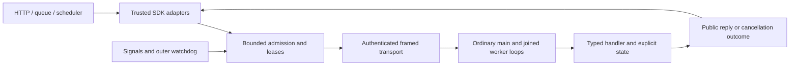

# Server Applications

Status: design record, 2026-10-23; domains: stdlib, CLI and tooling, runtime and host. Direction A is approved (#806, owner, 2026-10-23); the package/SDK boundary, deployment profile, and lifecycle and resource policies are not.
This answers [#806](https://github.com/HerringtonDarkholme/hd-lang/issues/806), including its [broader application scope](https://github.com/HerringtonDarkholme/hd-lang/issues/806#issuecomment-6377000423).
The linked prototypes are experiments, not a production server SDK.
No compiler, standard-library or specification change accompanies this proposal.

The records under review are [entry points](../../spec/lang/10-modules.md#entry-point), [instances](../../spec/lang/10-modules.md#instances-and-threads), [scheduling](../../spec/lang/11-requirements-and-suspension.md#r-req.schedule.yield-points), [Task](../../spec/std/task.md), [Net](../../spec/std/net.md), [Host](../../spec/std/host.md), and [CLI cancellation](../../spec/cli/command-line.md#cancelling-a-run).
[HTTP_SERVER.md](HTTP_SERVER.md) contributes measurements and an adapter experiment.
It records the decided HTTP shape: an ordinary `main!`, one retained instance, an SDK-owned `HttpServer` capability, and SDK packaging tasks (#266).
Its limits and grants remain unapproved.
[Policy Composition](POLICY_COMPOSITION.md) also remains a proposal.

## Contents

- [Problem, Users, Use Cases And Today](#problem-users-use-cases-and-today)
- [State Of The Art](#state-of-the-art)
- [Semantics](#semantics)
- [Options](#options)
- [Entry Point And Lifecycle](#entry-point-and-lifecycle)
- [Handlers And Routing](#handlers-and-routing)
- [Per-Request Concurrency, Cancellation And Deadlines](#per-request-concurrency-cancellation-and-deadlines)
- [Application State](#application-state)
- [Configuration And Secrets](#configuration-and-secrets)
- [Logging And Observability](#logging-and-observability)
- [Hosting On Node And Wasmtime](#hosting-on-node-and-wasmtime)
- [Architecture](#architecture)
- [Extension Points](#extension-points)
- [Cost](#cost)
- [Stress Test](#stress-test)
- [Phasing](#phasing)
- [Recommendation And Approvals](#recommendation-and-approvals)
- [Sources, Prototypes And Parse Log](#sources-prototypes-and-parse-log)

## Problem, Users, Use Cases And Today

An application owns resources and work over a lifetime.
It initializes, becomes ready, admits work, supervises failures, drains, and exits.
HTTP is one input adapter; queues, schedules and background jobs need the same lifetime model.
The intended user deploys one service, then needs to understand its state and failure boundaries.

The fixed cases stay the same for every option:

| Case | End-to-end requirement |
| --- | --- |
| U1: JSON API | Validate startup configuration, become ready, route a request, decode a typed body, and return JSON or a public error. |
| U2: load and shutdown | Bound admission; receive a stop signal with jobs active; reject queued work; finish admitted jobs; close resources; exit. |
| U3: background worker | Start a worker with the application, share explicitly named state, observe its failure, and stop it with the application. |
| U4: queue consumer | Decode a message, commit its effect, then acknowledge; distinguish retry, rejection and duplicate delivery. |
| U5: cron consumer | Receive scheduled ticks, choose an overlap policy, record completion, and handle a duplicate tick without inventing exactly-once execution. |

Today, ordinary `main!` can own a state object and drive several suspensions.
A fixed list of long-lived workers can use public `map_all!`; its work list need not contain every future request.
Two worker IDs are enough to start two loops that repeatedly receive new work.
No public `spawn` or external root table is required for that shape.

The [workers control](server-applications/prototypes/workers/src/main.hd) admits two jobs, receives a scripted soft stop, completes both, and leaves one queued.
Both engines print `admitted=2 completed=2 queued=1 workers=2`.
The [live transport](server-applications/prototypes/transport/src/lib.hd) keeps two Net connections in one application instance.
It receives framed work repeatedly instead of starting a process per message.

### Node Net Waits

A bang call is a possible yield point; it does not guarantee that its host implementation returns Pending.
Node Net reads, accepts and datagram receives return Pending and preserve unread bytes across cancellation ([#810](https://github.com/HerringtonDarkholme/hd-lang/issues/810), done).
The [minimal two-client program](server-applications/prototypes/read-concurrency/src/main.hd) writes `ready`, then waits for one byte in each child of `all!`, and exercises that path.
Polling with a mandatory Clock would add a dependency and periodic work; it is not used.
Long blocking Process and filesystem calls also need isolation or an explicit cooperative-provider contract.

### An Entry Convention Does Not Exist Yet

The [entry-gap package](server-applications/prototypes/entry-gap/hd.toml) declares `kind = "application"` with ordinary start, handle and stop functions.
Its build warns that `executable.0.kind` has no meaning and is ignored.
The resulting module is 407 bytes, with ordinary program exports and no application registration.
Checking public hooks is therefore not evidence that a host can invoke them.

`use std.host.Lifecycle` also reports `unknown-import: module 'std.host' declares no 'Lifecycle'`.
That missing item need not become a new capability: an external SDK can translate signals into ordinary control messages.
The live Wasmtime control already demonstrates that translation without changing the runtime ABI.
The application receives soft stop as data; existing root cancellation remains the later escalation.

## State Of The Art

### Go net/http

[Go's Server](https://pkg.go.dev/net/http) combines a listener, handler and connection lifecycle.
`Serve` starts service goroutines for accepted connections; application startup and signal handling stay in ordinary `main`.
`Shutdown(ctx)` stops admission and waits for active connections, while `Close` is the forceful alternative.
A shutdown context expiring does not make the handler's external effects transactional.

This covers normal HTTP serving and draining, with separate handling for hijacked connections.
It does not supply queue acknowledgement, cron overlap or an application supervision tree.
The useful division is a reusable server library under an application-owned main.
Adopt that division while making hd's single-instance scheduling limits explicit.

### axum And Tower

[axum serving](https://docs.rs/axum/latest/axum/serve/struct.Serve.html) returns an awaitable server with a caller-supplied graceful-shutdown future.
Its router provides HTTP extraction and composition, while [State](https://docs.rs/axum/latest/axum/extract/struct.State.html) carries application data.
Shared mutable state usually needs a suitable synchronization wrapper; holding the wrong mutex across an await can make a handler unusable.
This is not equivalent to hd's nonexclusive `&mut` references.

[Tower Service](https://docs.rs/tower/latest/tower/trait.Service.html) separates admission readiness from calling a service.
A ready service may accept a request; its clone need not share that readiness reservation.
Layers can add policies without becoming an application lifecycle system.
Borrow explicit admission and policy composition, but keep queue ownership and shutdown ordering visible.

### Node, Express And Hono

[Node's HTTP server](https://nodejs.org/api/http.html#serverclosecallback) exposes transport lifecycle separately from routing.
Closing admission and forcefully closing active connections are different operations; upgraded connections require separate accounting.
The event loop can still be blocked by guest or host code, so a timer in that loop is not a CPU preemption guarantee.
The hd Node Net probe exposes that distinction concretely.

[Express's shutdown guidance](https://expressjs.com/en/advanced/healthcheck-graceful-shutdown/) connects SIGTERM with admission stop, ongoing work, cleanup and exit.
It distinguishes readiness from liveness, which the proposed SDK should preserve.
[Hono's Node adapter](https://hono.dev/docs/getting-started/nodejs) wraps Node HTTP and leaves server closing to the caller.
A portable request API therefore does not remove the need for a platform lifecycle adapter.

### Erlang/OTP

[OTP supervision](https://www.erlang.org/doc/system/sup_princ.html) models child startup, restart policy, shutdown and escalation explicitly.
Its strategies distinguish restarting one child from restarting related children, and restart intensity limits repeated failure.
Children start in dependency order and normally stop in reverse order.
This is substantially more than catching an error and retrying forever.

hd cannot copy process isolation by placing several callbacks in one Wasm heap.
A trap can poison their shared instance, and its mutable state cannot be trusted for a local restart.
Borrow bounded supervision at the instance boundary and ordinary typed failures inside it.
Do not claim OTP's isolation or delivery semantics for shared `&mut` state.

### Spin And wasmCloud

[Spin triggers](https://spinframework.dev/v4/triggers) separate incoming HTTP, Redis and cron work from component code.
Its [HTTP executor](https://spinframework.dev/v4/http-trigger) makes instance policy part of hosting rather than ordinary handler syntax.
The distinction matters because reuse changes which globals can persist, without making them durable application storage.
Adopt explicit adapters and instance policy, without importing Component Model behavior implicitly.

[wasmCloud trigger services](https://wasmcloud.com/docs/overview/hosts/trigger-services/) pin a component instance and dispatch several ingress kinds to it.
Optional long-running CLI work can coexist with invocation tasks; replicas still have separate state.
This supports caches and pools but requires host-owned task roots, supervision and compatible component interfaces.
It is a useful reference for option B's cost, rather than proof that hd already has those mechanisms.

## Semantics

The application model reuses current language rules.
It adds no keyword, implicit trait conformance, exception channel or shared-memory thread.
The distinction between application policy and host scheduling remains observable.

| Concept | Existing rule and consequence | Counterexample or control |
| --- | --- | --- |
| Instance lifetime | [`module.instance.thread`](../../spec/lang/10-modules.md#r-module.instance.thread), `.parallel`, `.disjoint`: one instance has one thread and a separate heap. | A reference cannot share a counter with a second replica; `instance-state` starts independent state objects. |
| Value copies | [Collection Values](../../spec/lang/04-type-system.md#collection-values): copying state does not create shared application state. | `values` copies a Counter, changes the copy, and observes original 2 versus copy 9. |
| References | [`ref.place.alias`](../../spec/lang/13-values-and-references.md#r-ref.place.alias): aliases observe writes. | Pass one explicit `&mut State` to workers; do not imply exclusive access. |
| Captures and bindings | [`ref.capture.copy`](../../spec/lang/13-values-and-references.md#r-ref.capture.copy) and `.variable`: a captured reassignable reference binding is shared. | `values` rebinds its captured pointer and the closure observes 3. |
| Suspension | [`req.schedule.yield-points`](../../spec/lang/11-requirements-and-suspension.md#r-req.schedule.yield-points): sibling execution changes at bang calls. | `shared-state` reads before a wait and loses an increment: stale 1, current 2. |
| Rows and generics | [Requirement rows](../../spec/lang/11-requirements-and-suspension.md): the worker library preserves the callback's row. | The transport uses `$ R + Net`; the pure HTTP control imports neither Clock nor outbound Http. |
| Names and visibility | [Modules](../../spec/lang/10-modules.md): public functions remain ordinary functions unless an entry rule names them. | `kind = "application"` is ignored today; the entry-control shim calls hooks explicitly. |
| Typed failures | [Control flow](../../spec/lang/06-control-flow.md): ordinary Result failures stay values. | The typed adapter maps a concrete handler error to its public reply type; it does not erase the handler's error. |
| Cleanup | [`flow.defer.restricted`](../../spec/lang/06-control-flow.md#r-flow.defer.restricted), [`flow.using.cancel.wait`](../../spec/lang/06-control-flow.md#r-flow.using.cancel.wait). | A synchronous defer cannot perform asynchronous draining; `using` owns the stream's disposal. |
| Panics | [`flow.defer.panic`](../../spec/lang/06-control-flow.md#r-flow.defer.panic): pending defers do not run after a panic. | A poisoned instance is discarded; successful cancellation cleanup is a different outcome. |
| Cancellation | [`req.combinator.cancel-children`](../../spec/lang/11-requirements-and-suspension.md#r-req.combinator.cancel-children), `.race-losers-disposed`. | `race-cancel` completes zero jobs and runs cleanup once; it does not gracefully drain. |
| Net framing | [`std-net.read`](../../spec/std/net.md#r-std-net.read) and `.write`: reads may be partial; writes cover every byte. | The live control accumulates a bounded length-prefixed frame instead of assuming one read equals one message. |
| Grants | [`cli.cap.scope.net`](../../spec/cli/command-line.md#r-cli.cap.scope.net): scope includes the broker port. | An SDK permission to accept HTTP does not grant arbitrary outgoing Net or Http to the guest. |

## Options

### A: Ordinary Main, A Library, And An External SDK

`main!` initializes the application and calls an ordinary library.
The library owns a fixed worker group and explicit state; the SDK owns input transports, admission and process supervision.
The same worker can receive HTTP envelopes, queue messages or scheduled work.
Background tasks are explicitly joined siblings, rather than hidden handlers started by a declaration.

The [library main](server-applications/prototypes/live-library/src/main.hd) is executable today on the native live control.
Its [typed form](server-applications/prototypes/live-typed/src/main.hd) accepts a deserializable input, serializable reply and statically typed failure mapper.
The callback's requirements remain its own, so pure handling does not acquire Clock automatically.
A package can hide framing boilerplate without making `main!` special.

A production SDK must authenticate its private transport, bound queued data, handle deadlines and manage process groups.
The checked-in controller is a trusted local experiment, not that completed SDK.
Node Net waits are cooperative (#810), so the same worker arrangement supports concurrent input.
These are explicit costs of A, despite its lack of new compiler entry forms.

### B: Registered Application Hooks

A manifest would register initialization, dispatch, background and shutdown hooks for one application.
The host would retain their state and drive incoming jobs independently of a user-written worker main.
The hooks accept application-defined input and output types, rather than an HTTP-specific Request and Response pair.
The same hooks therefore serve queue, cron and worker adapters.

The [entry control](server-applications/prototypes/live-entry/src/main.hd) exercises initialization, dispatch and shutdown through a main shim.
That validates the hook bodies and shared-state behavior, not registration or a new embedding ABI.
The separate entry-gap experiment proves registration remains missing.
An implementation would need typed entry validation, serialization glue, retained state roots and a multi-root driver.

A host may enqueue callbacks only after the current Wasm call returns.
Calling another entry reentrantly while the instance is polling would violate the existing driver rules.
A trap fails every invocation sharing that instance; a restart creates new volatile state.
B consequently resembles a service runtime, with costs beyond naming a function `handle!`.

### C: A Command Per Job

The smallest deployment runs an ordinary command for each job under an external process manager.
Arguments or a private input stream provide the job; a deliberately constrained reply channel returns its result.
The manager owns admission, retries and shutdown, and each invocation starts with fresh state.
No new compiler entry or long-lived guest worker group is required.

This can serve a JSON API through a gateway and process independent queue or cron work.
A background worker becomes a sequence of supervised jobs, with persistence outside the instance.
It cannot provide a shared in-memory service counter, pool or cache across jobs.
Using stdout as the reply channel also makes accidental application logging a protocol error.

The [isolated-job control](server-applications/prototypes/isolated-job/src/main.hd) runs this arrangement on both engines.
Two separate queue invocations with ID 7 each commit once; neither remembers the other.
Fourteen process runs cover valid and invalid HTTP, background work, repeated queue messages and repeated cron ticks.
This is evidence for C's fresh-state limitation, not a long-lived server implementation.

### The Same Cases Under Each Option

| Case | A: library main | B: hook convention | C: command per job |
| --- | --- | --- | --- |
| U1 | SDK accepts HTTP; typed callback returns a reply; SDK writes the response. | Host routes a typed dispatch invocation; the control shim demonstrates its body. | Gateway starts a command and interprets its single explicit reply. |
| U2 | SDK closes admission, sends soft-stop control, waits for workers, then escalates. | Host stops dispatch roots, drains them, then calls shutdown. | Manager stops launches and waits for admitted child commands. |
| U3 | Main joins a named worker with the request workers; its state sharing is explicit. | A background root shares registered state and must be supervised. | Manager starts successive jobs; retained state needs external storage. |
| U4 | Queue adapter acknowledges only the completed reply; durable deduplication is external. | An invocation reply drives acknowledgement; a trap still leaves delivery uncertain. | Each command owns one attempt; local deduplication disappears on exit. |
| U5 | Scheduler adapter supplies tick IDs and an explicit overlap policy. | Scheduler dispatches the same application input type. | Scheduler starts commands; overlap and duplicate IDs remain its policy. |

A avoids new language and entry mechanisms.
B removes some source boilerplate but introduces a host-owned application runtime.
C is operationally simple for isolated work and gives up reusable guest state.
The recommendation is A, conditional on a production-quality SDK.

## Entry Point And Lifecycle

The proposed lifecycle is Starting, Ready, Draining, Cancelling, then Stopped or Failed.
Startup validates configuration, creates state and opens the SDK transport before advertising readiness.
An input queue being temporarily empty does not end an application.
Source exhaustion in the finite controls is only a test boundary.

The first supervisor stop closes admission and withdraws readiness.
It sends control messages to idle workers and allows admitted work to finish.
The main joins every worker before releasing shared state or returning.
A second stop or expired drain budget begins cancellation; a later outer deadline can kill the process group.

Existing direct `hd run app` signal behavior is not silently changed.
The proposed SDK is an explicit wrapper, runnable through an ordinary package task such as `hd run serve`.
It translates its own signal into a private control message before using existing guest cancellation as escalation.
The live SIGTERM tests exercise that distinction on macOS with Wasmtime.

Windows needs a service-control adapter and owned process-tree cleanup before claiming the same behavior.
Terminal-wide signals must not bypass the wrapper and cancel its guest prematurely.
Linux process-group behavior needs its own integration test; this draft's live evidence is macOS only.
No successful cleanup is claimed after a forceful host kill.

## Handlers And Routing

Routing belongs in ordinary application or package code.
The control uses one fixed `/greet` route; multi-route matching is an ordinary package extension, not a measured router.
An application may use a closed enum for several input kinds, or separate typed adapters for unrelated protocols.
HTTP methods and paths are application data, rather than entry-selection syntax.
Queue identifiers and scheduled ticks need their own metadata and acknowledgement rules.

The typed adapter keeps `I`, `O`, `E`, state `S` and row `R` static.
Invalid input maps to a caller-supplied public `O`; a concrete `E` maps through `fn(E) -> O`.
That mapping makes disclosure a deliberate boundary choice.
The low-level framing atom remains available for a custom codec.

| Checked prototype signature | Responsibility |
| --- | --- |
| `serve -> string $ R) -> Result[void, NetError] $ R + Net` | Trusted JSON-frame control, currently two workers. |
| `serve_typed -> Result[O, E] $ R, invalid: O, failed: fn(E) -> O) -> Result[void, NetError] $ R + Net` | Ordinary HD codec adapter preserving the handler's types and row. |

These are prototype APIs, not proposed std names.
A production package adds a validated endpoint, worker count, protocol version and authenticated session instead of a bare port.
It distinguishes transport failure from an application reply and never uses logs as HTTP responses.
The checked JSON control's UTF-8 and size restrictions are not a promise of streaming or arbitrary codec support.

## Per-Request Concurrency, Cancellation And Deadlines

A worker owns at most one admitted job at a time.
The SDK bounds both active workers and queued bytes; an unbounded listener backlog is not application backpressure.
A queue full response is adapter-specific: HTTP rejection, paused message consumption or a recorded skipped tick.
Readiness is withdrawn independently of liveness when admission stops.

Soft stop does not race against every active handler.
The `race-cancel` control shows why that would cancel the work being drained.
Per-job disconnect or deadline cancellation instead needs a job-local race whose normal result records cancellation.
Externally cancelling a shared child can cancel its awaiter and then the enclosing worker group.

Control messages require a session generation and lease ID.
A late cancellation for an old lease must never cancel its worker's next job.
Cancellation of a partially read frame also requires persistent decoder state outside the cancelled read suspension.
The prototype's simple local decoder is not sufficient for that production extension.

A guest deadline uses Clock only when application code explicitly chooses a timed operation.
The SDK's resource deadline is a host limit and needs an independent process or worker-realm backstop.
A CPU loop or blocking host call can prevent an in-realm timer from running.
The outer supervisor must report unconfirmed cleanup when it resorts to a hard stop.

## Application State

One application instance owns one explicitly created state object.
Handlers and background workers share it through references passed by main.
Code between yield points can maintain a small invariant, but a read, await and later write is not atomic.
The observed stale counter is 1 where the post-await update gives 2.

A state mutation must leave a valid object before suspending.
When it must span external work, use version checks, reservations or an external transaction.
A trap poisons the instance; its partially updated state is not a sound recovery point.
The supervisor fails its in-flight leases and starts a fresh instance under a bounded restart policy.

Replicas and restarts do not share this memory.
The instance-state control commits the same queue ID in two independent state objects.
Its in-memory duplicate check therefore demonstrates a local optimization, not exactly-once processing.
Durable effects and acknowledgement need an external idempotency or transaction protocol.

## Configuration And Secrets

Validate typed configuration before opening public admission.
Existing `env_decode` reads declared fields through an Env provider; default environment names are uppercase.
Configuration precedence should be explicit: deployment configuration, then an explicit local override.
Invalid ports, unknown adapter names, impossible limits and conflicting input ownership fail startup.

The config control uses ScriptedEnv with synthetic values only.
It accepts PORT 8080, rejects PORT 70000, and prints a redacted Secret.
A Secret wrapper can omit Serialize and provide a redacted Debug implementation.
Once code explicitly reveals a string, rows and redaction do not provide an information-flow guarantee.

The SDK owns credentials needed by its ingress adapters.
The guest receives only the declared configuration and narrowed outgoing grants.
A private broker session needs fresh authentication delivered through a private bootstrap channel, not logged arguments.
The unauthenticated local controller is not suitable for hostile peers or deployment secrets.

## Logging And Observability

Application Console output remains application output or logs.
The broker's dedicated connection carries work and replies, so an extra println cannot become an HTTP response.
SDK events use a separate stream with event kind, instance generation, lease ID, outcome and cleanup status.
Payloads, tokens and raw private errors are excluded by default.

Readiness reports admission ability, while liveness reports the supervisor and guest's progress.
Metrics include queued bytes, admitted jobs, active jobs, completed replies, rejected work, restart count and deadline escalation.
Host timing may be recorded by the SDK without injecting Clock into a pure guest handler.
Per-request tracing is a package callback, with its own explicit row and cost.

A handler's typed error becomes its declared public failure reply.
A transport failure or trap becomes an instance event, not a fabricated application error.
Only a confirmed guest cleanup completion is reported as such.
A killed process and a gracefully drained main have different observable outcomes.

## Hosting On Node And Wasmtime

The SDK can launch the ordinary executable under either existing hd engine.
The Wasmtime live controls use Net grants, repeated messages and one guest state across requests.
The Node business-logic controls pass, but live concurrent Net input remains blocked by the recorded provider behavior.
Advertising parity requires the pending-I/O implementation work and its regression tests first.

The reference SDK is a separate Node process hosting HTTP, queue simulation and control transport.
Its Wasmtime mode consequently still requires Node for this reference adapter.
A native SDK could replace it without changing the guest's entry or application types.
That deployment dependency is a cost, not a property of Wasmtime itself.

[`wasmtime serve`](https://docs.wasmtime.dev/cli-options.html#serve) accepts the relevant component HTTP interface.
An ordinary hd core-Wasm program does not acquire that interface by exporting a function with a convenient name.
A wasi:http adapter must translate ingress into the same application transport, or a separate component backend must be implemented.
Neither path is implemented or made implicit by this proposal.

The first implementation should target ordinary local or container services.
Cloudflare/Vercel integration must fit their actual lifetime and transport constraints before claiming support.
An environment that cannot host a long-lived worker needs an explicit isolated-job adapter or a later embedding mechanism.
This does not inherit the rejected handler convention from #266.

## Architecture

### Placement And Data Flow

The application and transport live in ordinary packages, outside `lib/std`.
The deployment SDK is a separate trusted process, outside the guest's polling thread.
Existing compilation, requirement binding, structured tasks and Net dispatch remain the compiler/runtime pipeline.
No new TIR node, intrinsic, syntax or application export is required by A.



The SDK opens ingress only after configuration, transport authentication and all required workers are ready.
Every worker owns one lease; the SDK retains the ingress reply or acknowledgement handle.
A worker decodes input, invokes application code, maps its typed error, and returns a correlated reply.
The SDK validates that reply before completing the ingress operation and returning the worker to idle.

### Records And Invariants

| Record | Fields and invariant |
| --- | --- |
| Deployment | Adapter names, explicit worker count, queue item/byte caps, frame cap, drain budget, hard-stop budget, restart intensity/window, guest grants. No guessed production defaults. |
| Session | Protocol version, random authentication material, instance generation, main control connection, expected worker count, authenticated slots, lifecycle phase. Reject unknown versions and stale generations. |
| Worker | Slot, generation, Idle/Busy/Stopping state, current lease, persistent data/control decoders, separate data/control transport handles. Never admit two jobs to one slot. |
| Lease | Monotonic ID, instance generation, adapter ID, reply handle, cancellation state, optional host deadline. IDs correlate work; possession does not confer authority. |
| Queue | FIFO items, aggregate encoded bytes, item cap, byte cap. Admission reserves bytes before allocating a complete queued item. |
| FrameReader | Four-byte header buffer, header offset, body length, body buffer, body offset. Commit progress before the next suspending read. |
| AppState[S] | Explicit shared `&mut S`, optional application version/reservation fields. Keep invariants valid at every possible yield point. |
| Drain | Reason, admission-closed flag, active lease count, drain deadline, escalation deadline, cleanup-confirmed flag. An exited process alone does not confirm cleanup. |

Protocol version 1 proposes Hello, Ready, Work, Reply, Cancel, Stop and Stopped envelopes.
Each carries its generation and worker slot; Work, Reply and Cancel also carry the lease ID.
Frames use a checked little-endian u32 byte length, followed by a versioned encoded envelope.
The prototype's simpler JSON frames demonstrate transport only; they do not implement this production protocol.

Main retains its authenticated control connection until worker joins and asynchronous finalization finish.
Stopped on that connection confirms application cleanup; a worker closing its data connection does not.
The supervisor accepts graceful completion only after that confirmation, zero active leases and a successful child exit.
It reports an unconfirmed failure if the child exits or the confirmation channel breaks earlier.

Use an authenticated private bootstrap stream for session material, then restrict Net to the exact broker endpoint.
ConsoleInput would be an explicit startup requirement when stdin supplies that bootstrap; applications cannot simultaneously consume that stream independently.
Reject conflicting input ownership before launch; never place the token in logs or diagnostic arguments.
Host permissions for ingress remain separate from the guest's outgoing grants.

### Supervision Algorithm

The following is host pseudocode, not a new hd API or implemented SDK.
The host event loop stays outside the guest process, so a blocked guest cannot prevent its hard-stop deadline.
The normal guest worker body uses the existing map_all group and typed callback shown by the prototypes.

```rust
fn supervise(config, adapters) {
    validate(config, adapters)?;
    let session = launch_private_session(config)?;
    let mut phase = Starting;
    let mut queue = BoundedQueue::new(config.queue_items, config.queue_bytes);
    let mut leases = LeaseTable::new(session.generation);
    loop {
        match next_host_event() {
            AuthenticatedReady(slot, generation) => {
                session.mark_ready(slot, generation)?;
                if phase == Starting && session.all_ready() {
                    phase = Ready;
                    adapters.open_admission();
                }
            }
            Incoming(item) if phase == Ready => {
                queue.reserve_and_push(item).or_else(reject_or_pause)?;
                dispatch_to_idle_workers(&session, &mut queue, &mut leases)?;
            }
            Incoming(item) => reject_without_guest_dispatch(item),
            Reply(slot, generation, id, output) => {
                let lease = leases.validate_current(slot, generation, id)?;
                finish_adapter_reply(lease, output)?;
                leases.release(lease);
                if phase == Ready { dispatch_to_idle_workers(&session, &mut queue, &mut leases)?; }
                else { stop_idle_workers(&session, &leases)?; }
            }
            FirstStop(reason) => {
                phase = Draining;
                adapters.close_admission();
                reject_queued(&mut queue);
                arm_drain_deadline(reason, config.drain_budget);
                stop_idle_workers(&session, &leases)?;
            }
            Disconnect(id) | JobDeadline(id) => send_cancel_for_current_lease(id, &leases)?,
            DrainExpired | SecondStop => {
                phase = Cancelling;
                cancel_current_leases(&leases)?;
                arm_hard_deadline(config.hard_stop_budget);
            }
            FinalizedAndExitedZero if leases.is_empty() => return close_and_report(Stopped, true),
            GuestTrap(error) | TransportFailure(error) => {
                fail_all_leases_without_ack(&mut leases, error);
                return discard_and_apply_bounded_restart(session, config);
            }
            HardDeadline => return kill_process_tree_and_report(Failed, false),
        }
    }
}
```

A job cancellation is a normal typed worker outcome, produced by a local race against its cancellation signal.
Its losing work is disposed before reusing the slot; the transport reader survives that race.
Do not externally cancel a child whose cancellation propagates through the worker's await into the whole map_all group.
If disposal never completes, retire the entire instance at the outer deadline.

Each worker's job races application work against reading its dedicated control connection.
The control branch reads until it sees a matching generation and lease, then returns a normal cancellation outcome.
If work wins, cancelling that read preserves its decoder object outside the branch; later reads discard stale lease messages.
This needs ordinary Net waits, not a custom notification primitive or Clock polling.

The SDK sends soft Stop only to idle workers on the data connection, leaving active jobs running during drain.
The main confirmation channel and per-worker data/control channels require `2N + 1` authenticated connections for N workers.
This extra orchestration belongs in the production package and is absent from the two-loop reference.
The partial-frame cancellation regression is a prerequisite before this design can claim safe slot reuse.

Soft stop closes admission before sending Stop to idle workers.
Busy workers send their reply and then stop; main joins them and performs explicit asynchronous finalization.
Background workers need their own stop event and joined completion, following the same ordering.
Startup failure and duplicate signals are idempotent transitions, not a second initialization or second acknowledgement.

### Local And Deployment Workflows

Locally, build the dev CLI and run the exact controller command in the [reproduction guide](server-applications/README.md).
A successful HTTP run writes its JSON result and exits zero; assertions or the outer watchdog make the controller fail.
The `signal` result includes active count, queued count and signal count, distinguishing the actual signal from a scripted stop.
This is a test workflow, not a new `hd serve` command.

Production would launch the pinned SDK with an explicit deployment file naming the package command and validated adapter settings.
The SDK starts ordinary `hd run --engine ENGINE`, with outgoing grants restricted to the broker and application needs.
No new `hd.toml` executable kind or CLI flag is proposed for A.
Command flags override deployment settings only where the SDK explicitly permits a local override; invalid combinations fail before guest startup.

The SDK's proposed event envelope contains `version: u32`, `event: string`, `generation: string`, `lease: string?`, `outcome: string?`, and `cleanup_confirmed: bool`.
Transport authentication material and application payloads are excluded.
A normal drained exit is zero; invalid configuration, transport failure, trap and hard stop are nonzero SDK outcomes with distinct event kinds.
Guest CLI statuses remain the existing CLI contract; they are not silently repurposed into HTTP status codes.

Package compilation may read normal dependencies and write its usual cache/build output.
The SDK creates its private bootstrap/transport resources and writes only explicitly configured logs or deployment artifacts.
It must not discover credentials or grant additional outgoing authority from request data.
CI runs adapter tests against owned loopback endpoints, with synthetic configuration and no deployment credentials.

### Memory, Cache And Test Boundaries

RC preserves reachable shared state; it does not serialize access or make mutations transactional.
Worker closures keep their state references alive until the group finishes.
Release completed lease payloads and replies promptly; bounded queues do not bound application-owned caches or reference cycles.
No guest reference crosses to another instance or the SDK; only encoded values cross that boundary.

The framer performs O(n) work per n-byte frame and checks lengths before allocating.
The prototype accumulates byte lists; a production buffer representation must measure temporary copies and decoded expansion.
Let N be workers, F the data frame cap, C the smaller control cap, Q queued bytes, and D per-worker decoded data.
A transport budget starts at `Q + N * (2F + C + D + metadata)`, plus state, runtime, main control and host buffers.

That expression is derived accounting, not a measured peak or an enforceable global heap cap.
JSON escaping and numeric byte arrays can expand data; cap actual frames, decoded bodies and application state independently.
Streaming bodies require a separate bounded stream codec and backpressure tests; the JSON reference does not provide them.
A cancelled partial frame retains committed decoder progress, otherwise its next header begins halfway through the previous message.

Normal compiler dependency hashes invalidate changed handlers, schemas and transport libraries.
Deployment arguments and secret values do not enter Wasm or compiler cache keys.
Compiled-module caches may be reused; mutable instances never become interchangeable cached values.
Record deployment configuration identity separately without including secret contents in logs.

Tests divide at the same boundaries: pure handlers, scheduler/cancellation controls, framed transport, and outer process supervision.
The reference covers finite semantics, repeated native dispatch, real HTTP replies and a real SDK SIGTERM.
Authentication, stale leases, fragmented cancellation, overflow, crash/restart and Windows process ownership require additional implementation tests.
No current green control certifies those missing components.

## Extension Points

Extensions are ordinary packages and explicit SDK adapters.
A custom protocol supplies a codec and typed handler; a custom policy wraps that handler using the existing suspension model.
Deployment adapters are trusted host code with declared permissions, rather than arbitrary imports loaded by the compiler.
A versioned private protocol must reject unsupported versions before dispatch.

A typed handler is the normal API; raw frames and codecs are the lower-level extension for binary protocols.
User policy code retains its own error type and requirement row; only timed policies introduce Clock.
This uses today's function values and generics, without committing to an unsettled #783 composition API.
The public error mapper is pure; applications log private errors separately through an explicitly declared capability.

SDK plugins execute with the SDK's authority and require explicit deployment configuration and version compatibility.
They cannot be treated as sandboxed hd dependencies.
The first version supports pinned adapters, not automatic plugin discovery or arbitrary package installation.
An eventual embedded runtime needs a separate stability and authority contract before sharing this boundary.

## Cost

### Measured Reference

All measurements use dev output at `4d2e52d27d4bd3456303f912fb22a57109aa1e72`, with one source-matched native-capable CLI.
Compiler SHA-256 is `3a4815ce257f595995339620ce3fb3fd4f150e692ceb8a9cc89da3554d058896`.
There are no production Rust, host or std edits in this job.
Function counts below count defined bodies; code bytes are the complete code-section payload, including its vector count.

| Program | Node bytes / functions / code bytes | Wasmtime bytes / functions / code bytes |
| --- | --- | --- |
| Unregistered entry gap | 407 / 5 / 40 | 407 / 5 / 40 |
| Pure JSON handler control | 140315 / 397 / 114144 | 147739 / 395 / 121661 |
| Finite library control | 195785 / 498 / 161651 | 204841 / 496 / 170821 |
| Finite hook-body shim | 205211 / 505 / 170612 | 214283 / 503 / 179798 |
| Live library | 330456 / 689 / 286805 | 354054 / 687 / 310524 |
| Live hook-body shim | 337701 / 696 / 293631 | 361299 / 694 / 317350 |
| Live typed library | 339890 / 705 / 295320 | 365363 / 703 / 320912 |
| Isolated command | 210995 / 525 / 173822 | 220566 / 523 / 183508 |

The finite shim adds 9426 Node bytes over the finite library; the live shim adds 7245 bytes.
These compare actual main-based programs, not a nonexistent registered-hook backend.
Typed live decoding adds 9434 Node bytes over raw live dispatch in this particular source.
Those differences include specialization and reachable library code, rather than a universal per-request tax.

One sequential build sample per program took 194–221 ms for the nontrivial Node packages and 120–149 ms for their Wasmtime versions.
The pure handler measured 224/107 ms; the empty entry gap measured 437/329 ms.
These wall times include cache and process effects, are not interleaved statistics, and establish no compile-time improvement.
The isolated-command runs likewise include compilation and startup; they cannot estimate warmed handler throughput.

There is no before/after runtime optimization in a docs-only job.
Live controls prove two in-flight leases and correct drain outcomes, not latency or saturation performance.
Before choosing production parameters, measure warmed throughput, p50/p99 latency, allocations and peak memory with paired interleaved baselines.
Keep SDK, startup, codec, handler and transport costs separate; retain outliers and rejected samples with reasons.

### Component Budget

The reference contains 77 physical/68 nonblank noncomment HD transport lines and 99/85 model lines.
The typed application contains 40/35 HD lines; the raw caller contains 13/12; the hook shim contains 21/16.
The SDK controller contains 298/293 JS lines; its bounded read-gap reproducer contains 95/92.
These are `wc -l` and simple lexical counts, not AST statement counts or estimates of complete production code.

Each row below replaces zero existing production lines: no production application SDK exists here.
Numbers in the additions column are proposed implementation budgets, calibrated against those reference pieces.
Tests are budgeted separately because security and cancellation coverage outweigh the happy-path prototype.

| Component | Replaced physical/code lines | Proposed added implementation lines | Reference and split |
| --- | --- | --- | --- |
| HD session/framing | 0 / 0 | 240 HD | 77-line transport; 80 incremental framer, 80 authenticated session, 80 envelope codec. |
| HD worker lifecycle | 0 / 0 | 180 HD | 27-line finite workers; 60 admission/stop, 80 contained cancellation, 40 error/finalization paths. |
| Typed outer API | 0 / 0 | 90 HD | Existing generic wrapper and 40-line typed caller; 50 codec/error mapping, 40 validated options. |
| SDK admission and protocol | 0 / 0 | 280 JS/TS | Local controller; 90 byte accounting, 100 generation/lease validation, 90 frame/session checks. |
| SDK supervision | 0 / 0 | 220 JS/TS | Local controller; 100 lifecycle/deadlines, 70 process ownership, 50 bounded restart policy. |
| HTTP and local worker adapters | 0 / 0 | 160 JS/TS | Prototype HTTP ingress; 100 bounded request/reply path, 60 worker adapter. |
| Queue and cron adapters | 0 / 0 | 160 JS/TS | Simulated events only today; 90 acknowledgement/retry, 70 overlap/tick identity. |
| Explicit config and event schema | 0 / 0 | 100 JS/TS + 50 HD | 28-line config control; 50 validation, 50 structured events, 50 typed bootstrap. |
| Focused tests and launch fixtures | 0 / 0 | 700 mixed | 200 framing/session, 180 cancellation/drain, 160 adapters, 160 failure/platform controls. |

The subtotal is 560 HD implementation lines, 920 SDK implementation lines and 700 focused test lines.
The Node Net work of #810 is done and is not part of that subtotal.
No shared compiler mechanism is removed; option B would additionally need checker, export glue and multi-root driver budgets.
Its main shim measures none of those additions, so B's production compiler cost remains unmeasured.

Stop a component for review when its implementation exceeds 1.5 times its allocated share.
Do not compensate for an overrun by silently consuming another component's test budget.
The package/SDK path predicts zero compiler gzip delta and zero size cost to programs that never import it.
Those are architectural expectations, not measurements of a future host patch or component backend.

The source-matched web compiler baseline is 5,709,379 raw bytes and 1,913,091 gzip bytes, using Node `gzipSync` level 9.
The 2,000,000-byte compressed cap remains hard; host-independent SDK code must not be bundled into the web compiler.
A later compiler option must report its own before/after gzip and stop at the cap.
No synthetic hook-body shim can demonstrate that cost.

## Stress Test

The ports translate the cited tools' application patterns, not their implementations or performance claims.
Each HD source is linked below and checked with today's compiler.
Verdicts distinguish an executed control from a design obligation with no implemented production mechanism.

The following original sketches explain the translated operation shapes; they are not copied library source or complete upstream examples.
The Go shutdown pattern maps to the `workers` and live `signal` controls:

```go
go server.Serve(listener)
<-stopSignal
server.Shutdown(drainContext)
```

The axum/Tower patterns map to `shared-state`, typed dispatch and bounded SDK admission.
A service's readiness belongs to that service instance, while application state needs its own synchronization discipline:

```rust
let observed = shared.counter;
external_work().await;
shared.counter = observed + 1; // logically stale even without parallel threads
service.ready().await?.call(request).await?;
```

The Node/Express/Hono lifecycle and JSON route map to actual HTTP ingress in the controller.
The HD translation uses a dedicated framed transport, preserving Console as a separate log channel:

```javascript
app.post("/greet", decodeThenHandle);
process.on("SIGTERM", () => server.close(afterActiveRequests));
```

OTP's supervised child boundary maps to a complete HD instance, rather than each callback in its shared heap:

```erlang
#{strategy => one_for_one, intensity => 3, period => 10}.
#{id => worker, start => {worker, start_link, []}, shutdown => 5000}.
```

Spin and wasmCloud ingress patterns map to the model's Http, Queue, Cron and Work variants.
Queue delivery and scheduled work need completion identities in addition to decoded business data:

```rust
match incoming {
    Http(request) => return_reply(handle(request).await),
    Message(message) => { commit(message.id).await?; acknowledge(message); }
    Tick(tick) => apply_overlap_policy(tick).await,
}
```

For executed controls, *works* means the observed result matches that shape's stated scope.
*Friction* means an explicit workaround or boundary limits the translation; *breaks* means today's implementation cannot supply the claimed operation.
The unimplemented adversarial cases receive *unproved*, rather than a passing verdict inferred from prose.

| Rank / borrowed pattern or attack | HD translation and observation | A / B / C consequence |
| --- | --- | --- |
| 1: concurrent stream waits, as in Go or axum connections | [read-concurrency](server-applications/prototypes/read-concurrency/src/main.hd): Wasmtime prints `1 1`; Node times out after one ready message. | #810 now makes Node waits cooperative; B needs the same cooperative providers; C isolates jobs but still needs correct providers inside each job. |
| 2: cancellation during a fragmented protocol read | The checked [transport](server-applications/prototypes/transport/src/lib.hd) stores partial data locally; cancelling that suspension would discard consumed header bytes. No cancellation experiment certifies recovery. | A needs persistent reader state and generation checks; B needs equivalent host ABI guarantees; C can discard the entire process. |
| 3: queue commit before acknowledgement, following broker consumers | [instance-state](server-applications/prototypes/instance-state/src/main.hd) commits ID 7 independently in two states. [isolated-job](server-applications/prototypes/isolated-job/src/main.hd) repeats it in separate processes. | None provides durable exactly-once effects; external idempotency or transactions remain required. |
| 4: Express shutdown with work active | [workers](server-applications/prototypes/workers/src/main.hd) and the live `signal` mode finish two admitted jobs and leave one queued; the SDK receives a real SIGTERM. | A passes natively; B's body shim passes without proving registration; C's manager must wait for admitted processes. |
| 5: racing stop against work | [race-cancel](server-applications/prototypes/race-cancel/src/main.hd) prints `winner=0 completed=0 cleaned=1` on both engines. | No option may call that graceful draining; soft stop and cancellation are separate phases. |
| 6: shared counter across await, analogous to axum State updates | [shared-state](server-applications/prototypes/shared-state/src/main.hd) produces stale 1 versus current 2 on both engines. | A and B need state invariants/versioning; C moves shared coordination to external storage. |
| 7: copied state and rebound capture | [values](server-applications/prototypes/values/src/main.hd) prints `original=2 copy=9 captured=3`. | A and B pass explicit references and stable bindings; C deliberately recreates state. |
| 8: OTP-style worker failure isolation | [poison](server-applications/prototypes/poison/src/main.hd) prints cleanup on normal completion, but no pending defer marker after a sibling panic on either engine. | A/B discard a poisoned shared instance; C limits the poisoned heap to one command. |
| 9: Hono/axum JSON extraction | [model](server-applications/prototypes/model/src/lib.hd) and `live-typed` return greeting JSON/200 or invalid-input/400. Native HTTP uses actual POST requests. | All three can represent the typed protocol; B's host invocation still needs implementation. |
| 10: pure handler accidentally acquires time or outbound HTTP | [pure-http](server-applications/prototypes/pure-http/src/main.hd) runs with Console alone on both engines. | A's generic row preserves purity; B must preserve it in glue; C's manifest cannot invent grants. |
| 11: configuration and accidental secret formatting | [config](server-applications/prototypes/config/src/main.hd) accepts 8080, rejects 70000, redacts a synthetic secret, then explicitly reveals its length. | All options validate before readiness; no wrapper promises information-flow security after reveal. |
| 12: Spin-like multiple ingress kinds | `library` and `entry-control` handle HTTP, work, queue and cron on both engines; native live modes reuse one instance. | A unifies lifecycle without HTTP syntax; B needs a generic dispatch ABI; C shares only external state. |
| 13: invented application registration | [entry-gap](server-applications/prototypes/entry-gap/src/service.hd) compiles to 407 bytes after ignoring `kind = application`. | A/C use real main; B remains a proposal, regardless of its shim's green tests. |
| 14: malicious size, stale reply, or old cancellation | Prototype checks frame size, but authentication, bounded queue admission and lease generations are absent. These are unimplemented adversarial requirements. | A requires protocol tests before deployment; B inherits equivalent trust boundaries; C still validates process input/output sizes. |

| Cases | A today | B today | C today |
| --- | --- | --- | --- |
| 1 | Breaks on Node; works natively. | Breaks: no registration; its shim has the same Node gap. | Friction: isolated jobs do not prove within-job cooperative waits. |
| 2, 14 | Unproved production safety. | Unproved production safety, plus missing ABI. | Friction: discarding a process avoids decoder reuse, but input validation remains necessary. |
| 3 | Friction: local deduplication only. | Friction in the body shim; missing ABI. | Friction: no cross-job memory at all. |
| 4 | Works natively. | Friction: main shim only. | Unproved process-manager drain. |
| 5 | Breaks if stop is naively raced against work. | Same lifecycle error. | Same lifecycle error when killing admitted commands. |
| 6, 7 | Works with explicit references and invariant-safe updates. | Works in the body shim, subject to the same rules. | Friction: shared updates move outside the guest. |
| 8 | Friction: restart whole instance. | Same shared-heap failure boundary. | Works with one poisoned command as the failure unit. |
| 9, 10, 11, 12 | Works for finite logic; native live modes work. | Friction: bodies work, host registration absent. | Works for isolated logic; retained service state is unavailable. |
| 13 | Works: ordinary main. | Breaks: registration ignored. | Works: ordinary main. |

The highest-risk cuts are cooperative host waits, cancellation-safe framing, and durable external effects.
Changing the entry convention fixes none of those three.
The chosen design therefore makes each a separate boundary with a focused regression test before adding deployment claims.
The prototype's two workers, 64 KiB frame and short sleeps are test parameters, not accepted deployment defaults.

## Phasing

Each slice targets roughly one hour and lands independently green after owner approval.
Split a slice rather than expanding its scope into a compiler or runtime rewrite.
No implementation phase is authorized by this document.

| Slice | Scope and proving test |
| --- | --- |
| 0 | Done (#810): cooperative Node Net. Two-child barrier and cancellation preserve unread bytes on both engines. |
| 1 | Package frame reader and writer. All header/body split points, EOF, invalid UTF-8 and oversize lengths; linear copied-byte counts. |
| 2 | Authenticated bootstrap and versioned envelopes. Reject wrong nonce/version/generation before Ready; no token in errors or logs. |
| 3 | Ordinary fixed worker group and typed facade. Four input kinds share one state; concrete error mapper and a no-Clock handler both check. |
| 4 | SDK queue and lease accounting. Item and byte caps hold under burst load; no duplicate completion or dispatch into a busy slot. |
| 5 | Soft stop and readiness. Real SIGTERM closes admission, completes admitted jobs and leaves queued work undispatched on both engines. |
| 6 | Contained per-job cancellation. Cancel half a frame and an active handler; other workers progress and late IDs cannot affect a new lease. |
| 7 | Hard-stop and restart policy. CPU-bound or blocking child is killed as an owned process tree; cleanup remains unconfirmed; restart intensity is bounded. |
| 8 | HTTP adapter. Real valid/invalid requests, bounded bodies, client disconnect, overload and public failure replies. |
| 9 | Queue adapter. Commit/ACK gap, duplicate IDs, retry and rejection; tests demonstrate external idempotency requirements without claiming exactly once. |
| 10 | Cron/background adapter. Explicit overlap policy, stable tick IDs, joined stop and worker failure. |
| 11 | Configuration/events and performance. Synthetic secret redaction, stable event schema, paired warmed baselines and heap/frame accounting. |

macOS live controls are current evidence; Linux process and signal tests must pass before a container profile ships.
Windows requires an owned process-tree mechanism and service-stop mapping, with native Windows tests before support is advertised.
The controller's Windows child kill fallback does not establish descendant cleanup.
Browsers lack this process/loopback deployment profile; wasi:http and edge platforms remain separate adapters or embedding work.

## Recommendation And Approvals

**Decided (owner, 2026-10-23):** direction A.
Retain an ordinary `main!`, put application orchestration in a package, and use explicit deployment SDKs for incoming protocols and supervision.
This reuses structured worker groups and avoids a new application entry mechanism.
Options B (registered hooks) and C (a command per job) are not chosen.

Approval is still needed for the package/SDK boundary, the supported deployment profile, and the proposed lifecycle and resource policies.
Component adapters, Windows supervision and production protocol security require their own completed work before deployment claims.
None of those approvals is assumed from #266.

## Sources, Prototypes And Parse Log

Primary sources are linked next to each tool's claims in the prior-art and hosting sections.
The [reproduction guide](server-applications/README.md) explains every control, its command and its limits.
All 18 HD source files parse, check and pass `hd fmt --check` on the source-matched compiler.
There are no unparsed HD fragments in this document; signatures are copied from the complete checked transport library.

Finite library and hook-body controls cover four use cases on both engines: 16 runs.
The three scheduler/state controls add six runs; pure HTTP, configuration, instance-state and value controls add eight.
Fourteen isolated-command runs and four normal/panic controls distinguish successful outcomes from intended failures.
The live native matrix covers three application shapes and six modes: 18 controller runs, including real signal delivery.

The two read-barrier controller runs assert different expected outcomes: native success and the bounded current Node failure.
A green gap-reproducer script therefore does not mean Node live parity.
Registered entries, component hosting, production authentication, cancellation-safe framing and crash recovery remain unimplemented.
No full suite was run for this documentation job.
