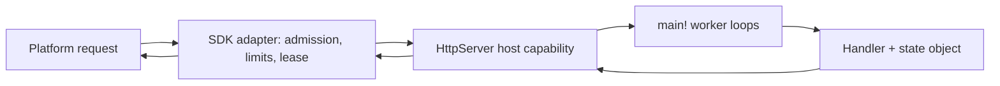

# Server Applications

Status: design record, 2026-10-24; direction decided (#806, #266).

Implemented: readiness, joined SDK workers, synchronous host turns and lease-owned I/O. Fetch transport, admission, bounded cleanup, Node supervision and request-associated logs are also implemented. Public runtime packaging, deployment tasks and hosted acceptance remain unfinished.

Package-declared host capabilities ([#51](https://github.com/HerringtonDarkholme/hd-lang/issues/51)) come first, then the adapters of [#266](https://github.com/HerringtonDarkholme/hd-lang/issues/266).

## Contents

- [Decided Design](#decided-design)
- [Use Cases](#use-cases)
- [What Works Today](#what-works-today)
- [Prior Art](#prior-art)
- [Lifecycle](#lifecycle)
- [Requests: Concurrency, Cancellation And Deadlines](#requests-concurrency-cancellation-and-deadlines)
- [Application State](#application-state)
- [Bodies And HTTP Mapping](#bodies-and-http-mapping)
- [Capabilities, Grants, Configuration And Secrets](#capabilities-grants-configuration-and-secrets)
- [Logging And Observability](#logging-and-observability)
- [Platforms And JSPI](#platforms-and-jspi)
- [Architecture](#architecture)
- [Packaging And Deployment](#packaging-and-deployment)
- [Queue And Cron Adapters](#queue-and-cron-adapters)
- [Cost And Measurements](#cost-and-measurements)
- [Stress Test](#stress-test)
- [Phasing](#phasing)
- [Open Approvals](#open-approvals)

## Decided Design

An application is an ordinary `main!`. There is no `handle!` entry, no manifest `kind`, and no HTTP-specific compiler convention; the entry rules are unchanged.
`main!` creates one explicit state object and joins a fixed group of worker loops over it with `all!` or `map_all!`.

`HttpServer` is a capability trait owned by a server SDK package and delivered through package-declared host capabilities (#51).
Its requests and responses are the existing boundary-safe `Request` and `Response` values from `std.http`.
Routing is ordinary hd code over `Request`.

One Wasm instance is retained per adapter. Each admitted request gets a lease: its ID, deadline, cancellation controller and the outgoing operations it owns.
Packaging is SDK tasks such as `hd run deploy-cloudflare` and `hd run deploy-vercel`; hd's core gains no `hd build` flag and stays platform-neutral.

```text
use dep.server_sdk.server.{HttpServer, serve}
use std.http.{Request, Response}

struct Hits:
    pub n: i64

fn handle!(req: Request, hits: &mut Hits) -> Response:
    hits.n = hits.n + 1
    Response { status: 200, body: "hit ${hits.n}".to_utf8() }

pub fn main!() -> void $ HttpServer:
    let mut hits = Hits { n: 0 }
    serve!(8, &mut hits, handle).expect("server")
```

The [SDK](../../packages/server-sdk/README.md) owns `serve!` and `HttpServer`; [Server SDK](../../spec/std/server-sdk.md) specifies their slice-1 interface.
Rejected shapes, each for one reason: a registered hook convention adds a host-owned application runtime; a command per job loses warm state; a fresh instance per request repeats initialization; a single instance with a queue lets one slow upstream delay unrelated requests.

## Use Cases

| Case | End-to-end requirement |
| --- | --- |
| U1: Cloudflare JSON API | Validate configuration, become ready, decode a typed JSON body, return JSON or 400. |
| U2: same app on Vercel | Rebuild the same source for Node or Edge; same responses and capability restrictions. |
| U3: local outgoing HTTP | `hd run`; a request awaits a granted upstream Http call; inspect the response and request log. |
| U4: timeout and disconnect | A handler uses `timeout!`; cleanup completes; the handler returns 504; a disconnect cancels outstanding work. |
| U5: load and shutdown | Bounded admission; on stop, reject queued work, finish admitted work, close resources, exit. |
| U6: background worker | A worker starts with the application, shares the named state, reports failure, stops with the application. |
| U7: queue and cron consumers | Commit then acknowledge; retry, rejection and duplicate delivery; scheduled ticks with an overlap policy. |

Out of scope: WebSockets, streaming bodies, durable objects, TLS termination and platform storage bindings. Each needs its own design.

## What Works Today

Current-compiler controls on Node and workerd 1.20261023.1 run the retained-instance shape:
- an ordinary `main!` with four joined worker loops and one state object serves sequential requests that count 1, 2, 3;
- four overlapping outgoing requests reach upstream concurrency four;
- with a lease-scoped I/O dispatcher in the SDK, an adversarial ordering (request A ready, B polls, B finishes) passes on both hosts.

These controls use a private Console bridge, not the public capability ([prototype](http-server/prototype/README.md)).
Node Net reads, accepts and receives return Pending and keep unread bytes across cancellation (#810), so several worker loops can wait at once.
The [server-application controls](server-applications/README.md) cover the lifecycle cases: two admitted jobs finish under a stop while one queued job is left, a stale read across an await, a poisoned instance, and typed JSON handling, on both engines.
Not yet proven: disconnect and deadline cleanup, body limits, packaging, Vercel, and hosted deployment.

## Prior Art

| System | Borrow | Do not borrow |
| --- | --- | --- |
| Go `net/http` | A server library under an application-owned `main`; `Shutdown` drains, `Close` forces. | — |
| axum and Tower | Explicit admission readiness, separate from calling; policy layers. | Mutex-guarded state across awaits; hd's `&mut` is not exclusive. |
| Node, Express, Hono | Closing admission is separate from closing connections; readiness differs from liveness. | A timer in the event loop is not CPU preemption. |
| Erlang/OTP | Bounded supervision and restart intensity, at the instance boundary. | Per-callback isolation; one Wasm heap shares its fate. |
| Spin | Explicit triggers; outbound permissions separate from ingress. | Component Model reuse semantics. |
| wasmCloud trigger services | A pinned instance serving several ingress kinds, with supervision. | WASI P3 ingress. |
| Fastly Compute | A small request-to-response boundary with a host-owned transport. | A blocking host API inside a V8 isolate. |
| Rust `worker` | Reuse the existing Request/Response types through thin platform adapters. | Exposing internal error text as a response. |

## Lifecycle

The lifecycle is Starting, Ready, Draining, Cancelling, then Stopped or Failed.
Startup validates configuration and creates state before the SDK advertises readiness; an empty input queue never ends the application.

The first stop closes admission and withdraws readiness, sends stop messages to idle workers, and lets admitted work finish.
`main!` joins every worker before it releases shared state or returns.
A second stop or an expired drain budget starts cancellation; a later outer deadline kills the instance.
Soft stop is not a race against active handlers: racing would cancel the work being drained (the `race-cancel` control completes zero jobs).

Direct `hd run app` signal behavior stays as it is. The SDK translates its own stop signal into a control message and uses guest cancellation only as the escalation.
Windows needs owned process-tree cleanup before the same behavior is claimed. No cleanup is claimed after a forceful kill.

## Requests: Concurrency, Cancellation And Deadlines

JavaScript schedules requests concurrently at suspension points; hd gains no shared-memory threads.
A worker owns at most one admitted request. Admission allows eight active requests per isolate, with no unbounded waiting queue; more get 503 with Retry-After and an overload event.

The SDK dispatches each outgoing operation to the coroutine of the request that owns it, even when another request caused the poll.
A lease is released only after the response bytes are copied out and cleanup finishes or is abandoned.
Late Promise callbacks check the closed lease's generation and never wake a later request.

The host deadline is 20 seconds from admission, with a 100 ms cleanup bound. A handler's shorter `timeout!` is ordinary library code whose error it maps to a response.
Disconnect requests graceful cancellation once, then abandons at the cleanup deadline; each outstanding fetch owns an AbortController.
Per-request cancellation is a job-local race whose result records cancellation; externally cancelling a shared child would cancel the whole worker group.
No request starts detached background work or relies on `waitUntil` in the first version.

A CPU loop never returns to JavaScript, so no in-isolate timer can stop it.
Node local hosting uses a bounded worker pool with one active request per worker and replaces a worker that misses its hard deadline; edge hosting relies on platform CPU limits.

## Application State

One instance owns one explicit state object, passed by reference to every worker loop.
It lasts as long as the retained instance and is not durable: a restart, a replica or an isolate eviction has its own state.
A read, an await and a later write are not atomic (the `shared-state` control reads 1 where the current value is 2), so a mutation leaves the object valid before it suspends, or uses versions or reservations.
A trap poisons the instance: every active request gets a generic 500 and the supervisor starts a fresh instance under a bounded restart policy.
Durable effects and exactly-once processing need an external service with idempotency keys or transactions.

## Bodies And HTTP Mapping

Whole bodies are enough for the fixed use cases. Limits: one MiB incoming body, one MiB response body, 64 KiB of headers.
An oversized body is rejected while its stream is read, before it is materialized; a declared Content-Length is checked early but actual bytes are still counted.
An oversized response is logged privately and answered with a generic 500 before headers are committed.

| Value | Mapping |
| --- | --- |
| Method | Standard spellings use `Method` variants; other valid tokens use `Other`; malformed tokens fail before hd. |
| URL | The absolute platform URL in `Request.url`; incoming `query = []`, since that field means extra outgoing pairs. |
| Headers | The pairs the platform exposes, including duplicates; never split a combined header; Set-Cookie uses the platform's multi-value path. |
| Body | Raw bytes, never implicitly UTF-8; the application decides on 400. |
| Status | Final statuses 200–599; no body for HEAD, 204, 205 or 304. |
| Framing | Hop-by-hop headers, Content-Length and transfer framing are host-owned and recomputed. |

Application errors are ordinary responses: a handler maps its validation error to 400 or an upstream failure to 502. An uncaught panic or trap becomes a generic 500 and a private event.

## Capabilities, Grants, Configuration And Secrets

Inbound delivery is the host's authority, not an outgoing Http grant. The local listener binds loopback unless told otherwise.

| Capability | Server profile |
| --- | --- |
| Http | Platform fetch with destination grants checked before effects and on every redirect (manual redirects). |
| Clock, Random | Host timers and cryptographic randomness, as today. |
| Console | Request-associated logs; never the response channel. |
| Env | Only named string bindings granted by the deployment. |
| Args, ConsoleInput | Unbound in a deployed application. |
| FsRead, FsWrite, Process, Net, Sys | Unbound in the portable server profile, including local parity mode. |

Local parity mode uses the same set, so an application cannot work locally only because it reached the filesystem.
Grants come from the package's `[capabilities]` table (#827); the deployment writes the outgoing allowlist into adapter configuration, never into Wasm.

Typed configuration is validated before admission opens, through `env_decode` and an Env provider; invalid values fail startup.
Secrets are named Env bindings read only when granted. They never enter generated JavaScript, caches, error responses, diagnostics or compiler cache keys.
A `Secret` wrapper without `Serialize` and with a redacting `Debug` prevents accidental formatting, not information flow after an explicit reveal.

## Logging And Observability

SDK events are versioned and separate from application logs: event kind, instance generation, request ID, status, elapsed time, outcome, and whether cleanup was confirmed.
Headers, bodies, Env values and credentials are excluded by default.
Readiness reports whether admission is open; liveness reports progress. Metrics: admitted, active, rejected and completed requests, queued bytes, restarts and deadline escalations.
A killed instance and a gracefully drained one report different outcomes.

## Platforms And JSPI

Published limits as of 2026-10-23; deployment validation reports the selected profile's current limits.

| Platform | Limits and packaging |
| --- | --- |
| Cloudflare Workers | 64 MiB uncompressed bundle, 128 MB per isolate including Wasm, one-second startup; static precompiled Wasm import. |
| Vercel Node | 250 MB uncompressed bundle, 4.5 MB request/response payload. The default Vercel target. |
| Vercel Edge | Static Wasm imports only, response start within 25 s, 1/2/4 MB gzip by plan; targeted through the Build Output API, not Next.js `runtime = 'edge'`. |
| Node (local) | The SDK's development listener; the only place package host capabilities run outside the edge. |
| wasmtime (`hd` CLI) | A program that needs a package `@host` capability is refused before it starts (#51); there is no wasmtime listener. |

An ordinary bang call returns Pending from its poll function, so JavaScript awaits I/O outside Wasm without JSPI.
`block_on` over real JavaScript I/O is different: waiting on the same thread prevents the Promise from completing.
The runtime checks for a ready completion inside `rt.block`; without JSPI an actually pending synchronous wait fails that request with an explicit host error and never spins.
workerd 1.20261023.1 exposes JSPI (`Suspending`, `promising`); the Edge VM test runtime does not. JSPI support is an optional, separately tested adapter feature.
workerd rejects `fetch(..., {redirect: "error"})`, so the provider implements hd's redirect policy with manual redirects.

## Architecture



The adapter admits a request, reads its body within the limits, creates a lease and hands the request to the `HttpServer` capability.
A worker loop takes it, runs the handler and returns the `Response`; the adapter copies it out, closes the lease's operations and timers, and answers the platform.
Requests cross the host boundary as structured values copied out of the exchange buffer; no reference, suspension or host object crosses.
Cancellation, deadlines and cleanup use the existing root protocol (`poll`, `wake`, `cancel`, `abandon`) per lease.
New platform bindings are SDK extensions: each needs a typed capability and grant checks before hd code sees it.
Compiled modules may be cached and reused; mutable instances never are. Secret values never enter a cache key.

## Packaging And Deployment

Each SDK task takes the built `build/<profile>/NAME.wasm` and writes the platform wrapper, the Wasm asset, host modules, the generated provider glue (#51) and platform config, under its output directory with atomic replacement.
A task never uploads, never asks for credentials, and never overwrites unrelated platform files.

| Use case | Commands and result |
| --- | --- |
| U1 | `hd build`; `hd run deploy-cloudflare`; Wrangler dry run; deploy; POST JSON; typed JSON or 400. |
| U2 Node | `hd run deploy-vercel` writes `.vercel/output`; `vercel deploy --prebuilt`. |
| U2 Edge | The same task with an Edge option writes the static Wasm import and Edge config. |
| U3, U4 | `hd run` starts the local Node listener; `/timeout` returns 504; a disconnect aborts the fetch. |

| Artifact | Contents |
| --- | --- |
| Cloudflare | Entry ES module, static Wasm module, host graph, Wrangler config with named bindings. |
| Vercel Node | Build Output v3 config, catch-all route, Node function directory, `.vc-config.json`, JS entry and Wasm. |
| Vercel Edge | Build Output v3 config, Edge function with `runtime: "edge"`, explicit env names, static Wasm import. |

Each target must pass the platform's own build validation before it ships; a local VM run is not evidence that hosted bundling handles the Wasm import.
Generated files work on macOS, Linux and Windows without shell-specific steps.

## Queue And Cron Adapters

Queues and schedules reuse the same `main!`, worker loops and lifecycle; only the adapter differs.
A queue adapter acknowledges a message only after the handler's reply, and distinguishes retry, rejection and duplicate delivery; local deduplication is an optimization, never exactly-once.
A cron adapter supplies stable tick IDs and an explicit overlap policy.
Both come after the HTTP adapters.

## Cost And Measurements

Measured on the current controls, not on finished SDK code:

| Quantity | Value |
| --- | --- |
| HTTP control Wasm | 317,485 bytes, 113,289 gzip; 704 functions. |
| Initial memory | 64 KiB heap plus 64 KiB exchange after a small request. |
| Fresh instantiation (Node 24, same compiled module) | median 0.046 ms, p95 0.070 ms. |
| JS host graph | 116,692 bytes before bundling; JS + Wasm 149,310 bytes gzip. |
| Concurrent fetch | Eight active upstream requests on Node, workerd and the Edge VM. |

Eight requests with one MiB bodies can hold several copies each, so the adapter needs an aggregate byte budget, not only a per-body check.
Profile maximum-sized bodies with eight overlapping requests before release, and lower the limits if peak isolate memory exceeds 100 MiB.

A program that links no server SDK pays nothing: no exports, helpers or imports, and its Wasm is byte-identical.
The SDK, its capability and each adapter are budgeted bottom-up in their own issues before code, and each stops for review above 1.5 times its budget.
The web compiler's two MB gzip cap is hard; host-only SDK code is never bundled into it.

## Stress Test

| Case (real shape) | Status |
| --- | --- |
| Hono JSON route; Axum malformed JSON → 400 | Control passes on the three JS hosts. |
| Invalid UTF-8 body reaches the decoder as bytes | Node control returns 400. |
| Fetch proxy; eight concurrent handlers | Controls pass without JSPI. |
| Tower timeout → 504 | Controls pass. |
| Go request-context cancellation | Node aborts the fetch once; downstream signal parity is required. |
| Shared counter across requests | Counts 1, 2, 3 on Node and workerd; stale read across an await is demonstrated. |
| Express shutdown with work active | Two admitted jobs finish, one queued job is left. |
| Racing stop against work | Completes zero jobs: soft stop and cancellation stay separate phases. |
| Express two Set-Cookie headers | Required adapter test. |
| Chunked upload past one MiB | Required bounded-reader test. |
| HEAD and 204 with a body | Required mapping test. |
| Redirect to a denied or local address | Required manual-redirect grant test. |
| Wake after disposal, slot reused | Required generation test. |
| CPU loop or trap | Trap fails every active request on the instance; Node hard timeouts and supervision required. |

The highest risks are unbounded buffering, delayed cancellation and capability bypass on redirects; typing does not catch any of them, so each gets a focused test before a deployment claim.

## Phasing

Each slice is about an hour, keeps existing commands green, and ships its spec rules and fixtures with its code.

| Slice | Deliverable | Acceptance |
| --- | --- | --- |
| 0 | #51: package-declared host capabilities. | Owned by #51. |
| 1 | `HttpServer` capability and SDK worker loops over `main!`. | Typed request/response round trip; one instance serves sequential requests. |
| 2 | Lease-scoped I/O dispatcher and cleanup. | Pending/wake/cancel/abandon, late completion, trap; adversarial interleaving. |
| 3 | Fetch provider over platform APIs. | Http cases for redirects, grants, errors and bodies on Node, workerd and the Edge VM. |
| 4 | Bounded adapter, admission, lifecycle. | Limits, cookies, bodyless statuses, overload, drain on stop, eight concurrent requests. |
| 5 | Node development listener and supervision. | U3, U4, U5; disconnect; CPU-loop termination; macOS, Linux and Windows coverage. |
| 6 | `deploy-cloudflare`. | Static Wasm dry run; local workerd U1–U4; size, startup and memory measured. |
| 7 | `deploy-vercel`, Node. | Build Output validation; payload cap and deadline behavior. |
| 8 | `deploy-vercel`, Edge. | Platform build validation; Edge VM U1–U4 without JSPI; the pending-sync-wait error. |
| 9 | Optional JSPI driver. | workerd pending `block_on` fetch, cancellation during suspension. |
| 10 | Queue and cron adapters. | Commit/acknowledge, duplicates, retry; overlap policy and tick IDs. |

## Open Approvals

The limits and overload policy, the server-profile grants, the pending-sync-wait behavior, the lifecycle and restart policies, and the SDK boundary still need owner approval.
Local VM and workerd runs do not replace platform build validation or deployed acceptance tests.
