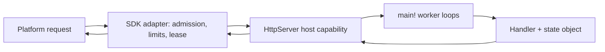

# Server Applications

Status: design record, 2026-10-24; direction decided (#806, #266).

Implemented: readiness, joined SDK workers, synchronous host turns and lease-owned I/O. Fetch transport, admission, bounded cleanup, Node supervision and request-associated logs are also implemented. The installed SDK carries its portable runtime.

Cloudflare task preparation, Wrangler dry runs and local workerd correctness probes are implemented on the current branch. The probes cover named Env, outgoing Http policy, Clock/Random, timeouts, cleanup and retained-state recovery. External cold wall latency and guest linear-memory observations are recorded below.

Vercel Node packaging also has local official builder and launcher evidence. Hosted acceptance, CPU startup and aggregate isolate memory remain unproven.

Package-declared host capabilities ([#51](https://github.com/HerringtonDarkholme/hd-lang/issues/51)) come first, then the adapters of [#266](https://github.com/HerringtonDarkholme/hd-lang/issues/266).

## Contents

- [Decided Design](#decided-design)
- [Use Cases](#use-cases)
- [What Works Today](#what-works-today)
- [Prior Art](#prior-art)
- [Lifecycle](#lifecycle)
- [Requests: Concurrency, Cancellation And Deadlines](#requests-concurrency-cancellation-and-deadlines)
- [Application State](#application-state)
- [Bodies And HTTP Mapping](#bodies-and-http-mapping)
- [Capabilities, Grants, Configuration And Secrets](#capabilities-grants-configuration-and-secrets)
- [Logging And Observability](#logging-and-observability)
- [Platforms And JSPI](#platforms-and-jspi)
- [Architecture](#architecture)
- [Packaging And Deployment](#packaging-and-deployment)
- [Queue And Cron Adapters](#queue-and-cron-adapters)
- [Cost And Measurements](#cost-and-measurements)
- [Stress Test](#stress-test)
- [Phasing](#phasing)
- [Open Approvals](#open-approvals)

## Decided Design

An application is an ordinary `main!`. There is no `handle!` entry, no manifest `kind`, and no HTTP-specific compiler convention; the entry rules are unchanged.
`main!` creates one explicit state object and joins a fixed group of worker loops over it with `all!` or `map_all!`.

`HttpServer` is a capability trait owned by a server SDK package and delivered through package-declared host capabilities (#51).
Its requests and responses are the existing boundary-safe `Request` and `Response` values from `std.http`.
Routing is ordinary hd code over `Request`.

One Wasm instance is retained per adapter. Each admitted request gets a lease: its ID, deadline, cancellation controller and the outgoing operations it owns.
Packaging is SDK tasks such as `hd run deploy-cloudflare` and `hd run deploy-vercel`; hd's core gains no `hd build` flag and stays platform-neutral.

```text
use dep.server_sdk.server.{HttpServer, serve}
use std.http.{Request, Response}

struct Hits:
    pub n: i64

fn handle!(req: Request, hits: &mut Hits) -> Response:
    hits.n = hits.n + 1
    Response { status: 200, body: "hit ${hits.n}".to_utf8() }

pub fn main!() -> void $ HttpServer:
    let mut hits = Hits { n: 0 }
    serve!(8, &mut hits, handle).expect("server")
```

The [SDK](../../packages/server-sdk/README.md) owns `serve!` and `HttpServer`; [Server SDK](../../spec/std/server-sdk.md) specifies their public interfaces and the Cloudflare deployment boundary.
Rejected shapes, each for one reason: a registered hook convention adds a host-owned application runtime; a command per job loses warm state; a fresh instance per request repeats initialization; a single instance with a queue lets one slow upstream delay unrelated requests.

## Use Cases

| Case | End-to-end requirement |
| --- | --- |
| U1: Cloudflare JSON API | Validate configuration, become ready, decode a typed JSON body, return JSON or 400. |
| U2: same app on Vercel | Rebuild the same source for Vercel Node; same responses and capability restrictions. |
| U3: local outgoing HTTP | `hd run`; a request awaits a granted upstream Http call; inspect the response and request log. |
| U4: timeout and disconnect | A handler uses `timeout!`; cleanup completes; the handler returns 504; a disconnect cancels outstanding work. |
| U5: load and shutdown | Bounded admission; on stop, reject queued work, finish admitted work, close resources, exit. |
| U6: background worker | A worker starts with the application, shares the named state, reports failure, stops with the application. |
| U7: queue and cron consumers | Commit then acknowledge; retry, rejection and duplicate delivery; scheduled ticks with an overlap policy. |

Out of scope: WebSockets, streaming bodies, durable objects, TLS termination and platform storage bindings. Each needs its own design.

## What Works Today

Current-compiler controls on Node and workerd 1.20261023.1 run the retained-instance shape:
- an ordinary `main!` with four joined worker loops and one state object serves sequential requests that count 1, 2, 3;
- four overlapping outgoing requests reach upstream concurrency four;
- with a lease-scoped I/O dispatcher in the SDK, an adversarial ordering (request A ready, B polls, B finishes) passes on both hosts.

These controls use a private Console bridge, not the public capability ([prototype](http-server/prototype/README.md)).
Node Net reads, accepts and receives return Pending and keep unread bytes across cancellation (#810), so several worker loops can wait at once.
The [server-application controls](server-applications/README.md) cover the lifecycle cases: two admitted jobs finish under a stop while one queued job is left, a stale read across an await, a poisoned instance, and typed JSON handling, on both engines.
The maintained SDK controls now cover disconnect and deadline cleanup, body limits, outgoing grants and Node supervision. Cloudflare packaging has local Wrangler dry-run, retained-application, policy and timeout evidence. Local probes also measure external cold wall latency and both guest linear memories. Vercel Node packaging has local official builder and launcher evidence; hosted deployment remains unproven.

## Prior Art

| System | Borrow | Do not borrow |
| --- | --- | --- |
| Go `net/http` | A server library under an application-owned `main`; `Shutdown` drains, `Close` forces. | — |
| axum and Tower | Explicit admission readiness, separate from calling; policy layers. | Mutex-guarded state across awaits; hd's `&mut` is not exclusive. |
| Node, Express, Hono | Closing admission is separate from closing connections; readiness differs from liveness. | A timer in the event loop is not CPU preemption. |
| Erlang/OTP | Bounded supervision and restart intensity, at the instance boundary. | Per-callback isolation; one Wasm heap shares its fate. |
| Spin | Explicit triggers; outbound permissions separate from ingress. | Component Model reuse semantics. |
| wasmCloud trigger services | A pinned instance serving several ingress kinds, with supervision. | WASI P3 ingress. |
| Fastly Compute | A small request-to-response boundary with a host-owned transport. | A blocking host API inside a V8 isolate. |
| Rust `worker` | Reuse the existing Request/Response types through thin platform adapters. | Exposing internal error text as a response. |

## Lifecycle

The lifecycle is Starting, Ready, Draining, Cancelling, then Stopped or Failed.
Startup validates configuration and creates state before the SDK advertises readiness; an empty input queue never ends the application.

The first stop closes admission and withdraws readiness, sends stop messages to idle workers, and lets admitted work finish.
`main!` joins every worker before it releases shared state or returns.
A second stop or an expired drain budget starts cancellation; a later outer deadline kills the instance.
Soft stop is not a race against active handlers: racing would cancel the work being drained (the `race-cancel` control completes zero jobs).

Direct `hd run app` signal behavior stays as it is. The SDK translates its own stop signal into a control message and uses guest cancellation only as the escalation.
Windows needs owned process-tree cleanup before the same behavior is claimed. No cleanup is claimed after a forceful kill.

## Requests: Concurrency, Cancellation And Deadlines

JavaScript schedules requests concurrently at suspension points; hd gains no shared-memory threads.
A worker owns at most one admitted request. Admission allows eight active requests per isolate, with no unbounded waiting queue; more get 503 with Retry-After and an overload event.

The SDK dispatches each outgoing operation to the coroutine of the request that owns it, even when another request caused the poll.
A lease is released only after the response bytes are copied out and cleanup finishes or is abandoned.
Late Promise callbacks check the closed lease's generation and never wake a later request.

The host deadline is 20 seconds from admission, with a 100 ms cleanup bound. A handler's shorter `timeout!` is ordinary library code whose error it maps to a response.
Disconnect requests graceful cancellation once, then abandons at the cleanup deadline; each outstanding fetch owns an AbortController.
Per-request cancellation is a job-local race whose result records cancellation; externally cancelling a shared child would cancel the whole worker group.
No request starts detached background work or relies on `waitUntil` in the first version.

A CPU loop never returns to JavaScript, so no in-isolate timer can stop it.
Vercel Node hosting uses a bounded worker pool with one active request per worker. It replaces a worker that misses its hard deadline under the supplied restart policy. Cloudflare hosting relies on platform CPU limits.

## Application State

One instance owns one explicit state object, passed by reference to every worker loop.
It lasts as long as the retained instance and is not durable: a restart, a replica or an isolate eviction has its own state.
A read, an await and a later write are not atomic (the `shared-state` control reads 1 where the current value is 2), so a mutation leaves the object valid before it suspends, or uses versions or reservations.
A trap poisons the instance: every active request gets a generic 500 and the supervisor starts a fresh instance under a bounded restart policy.
Durable effects and exactly-once processing need an external service with idempotency keys or transactions.

## Bodies And HTTP Mapping

Whole bodies are enough for the fixed use cases. Limits: one MiB incoming body, one MiB response body, 64 KiB of headers.
An oversized body is rejected while its stream is read, before it is materialized; a declared Content-Length is checked early but actual bytes are still counted.
An oversized response is logged privately and answered with a generic 500 before headers are committed.

| Value | Mapping |
| --- | --- |
| Method | Standard spellings use `Method` variants; other valid tokens use `Other`; malformed tokens fail before hd. |
| URL | The absolute platform URL in `Request.url`; incoming `query = []`, since that field means extra outgoing pairs. |
| Headers | The pairs the platform exposes, including duplicates; never split a combined header; Set-Cookie uses the platform's multi-value path. |
| Body | Raw bytes, never implicitly UTF-8; the application decides on 400. |
| Status | Final statuses 200–599; no body for HEAD, 204, 205 or 304. |
| Framing | Hop-by-hop headers, Content-Length and transfer framing are host-owned and recomputed. |

Application errors are ordinary responses: a handler maps its validation error to 400 or an upstream failure to 502. An uncaught panic or trap becomes a generic 500 and a private event.

## Capabilities, Grants, Configuration And Secrets

Inbound delivery is the host's authority, not an outgoing Http grant. The local listener binds loopback unless told otherwise.

| Capability | Server profile |
| --- | --- |
| Http | Platform fetch with destination grants checked before effects and on every redirect (manual redirects). |
| Clock, Random | Host timers and cryptographic randomness, as today. |
| Console | Request-associated logs; never the response channel. |
| Env | Only named string bindings granted by the deployment. |
| Args, ConsoleInput | Unbound in a deployed application. |
| FsRead, FsWrite, Process, Net, Sys | Unbound in the portable server profile, including local parity mode. |

Local parity mode uses the same set, so an application cannot work locally only because it reached the filesystem.
Grants come from the package's `[capabilities]` table (#827); the deployment writes the outgoing allowlist into adapter configuration, never into Wasm.

Typed configuration is validated before admission opens, through `env_decode` and an Env provider; invalid values fail startup.
The SDK deploy tasks read the root production `[capabilities]` directly from `hd.toml` at deploy time, using one shared SDK reader. They preserve explicit true, false and scope lists and exclude `[dev-capabilities]`. There is no `NAME.host.json` build companion; `hd build` remains policy-free. Any deployment fingerprints or ABI identity are computed by the SDK task.

Secrets are named Env bindings read only when granted. They never enter generated JavaScript, caches, error responses, diagnostics or compiler cache keys.
A `Secret` wrapper without `Serialize` and with a redacting `Debug` prevents accidental formatting, not information flow after an explicit reveal.

## Logging And Observability

SDK events are versioned and separate from application logs: event kind, instance generation, request ID, status, elapsed time, outcome, and whether cleanup was confirmed.
Headers, bodies, Env values and credentials are excluded by default.
Readiness reports whether admission is open; liveness reports progress. Metrics: admitted, active, rejected and completed requests, queued bytes, restarts and deadline escalations.
A killed instance and a gracefully drained one report different outcomes.

## Platforms And JSPI

Published limits recorded on 2026-10-23; Cloudflare Worker size rechecked on 2026-10-25. Deployment validation reports the selected profile's current limits.

| Platform | Limits and packaging |
| --- | --- |
| Cloudflare Workers | [64 MiB uncompressed bundle](https://developers.cloudflare.com/workers/platform/limits/#worker-size), 128 MB per isolate including Wasm, one-second startup; static precompiled Wasm import. |
| Vercel Node | 250 MB uncompressed bundle, 4.5 MB request/response payload. The default Vercel target. |
| Node (local) | The SDK's development listener and worker-supervision components. |
| wasmtime (`hd` CLI) | A program that needs a package `@host` capability is refused before it starts (#51); there is no wasmtime listener. |

An ordinary bang call returns Pending from its poll function, so JavaScript awaits I/O outside Wasm without JSPI.
`block_on` over real JavaScript I/O is different: waiting on the same thread prevents the Promise from completing.
The runtime checks for a ready completion inside `rt.block`. Without JSPI, a pending synchronous wait fails the request with an explicit host error and never spins.
The workerd 1.20261023.1 runtime exposes JSPI (`Suspending`, `promising`). The historical Edge VM probe lacked JSPI. JSPI support is an optional, separately tested adapter feature.
workerd rejects `fetch(..., {redirect: "error"})`, so the provider implements hd's redirect policy with manual redirects.

## Architecture



The adapter admits a request, reads its body within the limits, creates a lease and hands the request to the `HttpServer` capability.
A worker loop takes it, runs the handler and returns the `Response`; the adapter copies it out, closes the lease's operations and timers, and answers the platform.
Requests cross the host boundary as structured values copied out of the exchange buffer; no reference, suspension or host object crosses.
Cancellation, deadlines and cleanup use the existing root protocol (`poll`, `wake`, `cancel`, `abandon`) per lease.
New platform bindings are SDK extensions: each needs a typed capability and grant checks before hd code sees it.
Compiled modules may be cached and reused; mutable instances never are. Secret values never enter a cache key.

## Packaging And Deployment

The implemented Cloudflare task takes the built Wasm and its generated binding companion through the SDK's `deployment` module. It emits the platform wrapper, captured Wasm, rebuilt SDK bindings, portable host graph, production grants and Wrangler configuration. The [Server SDK specification](../../spec/std/server-sdk.md#cloudflare-deployment) defines this boundary.

An ordinary `hd run deploy-cloudflare` task uses the installed SDK's package-declared Deployment provider. Task execution requires its own capability consent; application deployment uses only the selected root's production grants. Artifact paths resolve from the task's root package. A task never uploads, asks for credentials, or overwrites unrelated platform files.

Preparation captures the artifact bytes once, checks source consent and nominal SDK identity, and validates their package-host contract against SDK-owned ABI data. The binding companion's data header must match the Wasm; its JavaScript body is neither evaluated nor shipped. SDK-owned code rebuilds the bindings. Schema and runtime fingerprints record compatibility and provenance, rather than authenticating arbitrary compiler output.

Cloudflare output uses immutable payload generations and an atomically replaced regular `wrangler.json` selector. Previous generations remain available to old readers. Preparation validates SDK-owned paths and preserves unrelated root files and platform caches. The SDK lock coordinates SDK writers; other writers must not edit reserved paths concurrently.

The SDK ships the source-hashed portable runtime and expected server ABI data with its provider. No compiler checkout, compiler-cache path, new build flag or policy-bearing build companion is required. Wrangler dry runs and local workerd requests validate this branch's Cloudflare output. The Vercel Node task uses the same safe artifact validation path. Hosted acceptance remains unproven.

The ordinary `deploy-vercel` task emits Build Output version 3 for the Node runtime through the same Deployment capability. Its explicit supervisor policy selects one to eight retained worker instances; state belongs to each worker. Unavailable capacity returns 503 immediately, including while workers start. Request deadlines remain twenty seconds, with the existing cleanup and watchdog bounds.

Vercel's `config.json` selects a complete immutable function generation under `functions/`. The SDK retains old generations, validates reserved paths and preserves unrelated root files and caches. Selected Env string values are captured at Node entry initialization and checked against production grants in each worker. No values enter generated output.

| Use case | Commands and result |
| --- | --- |
| U1 | `hd build`; `hd run deploy-cloudflare`; Wrangler dry run; deploy; POST JSON; typed JSON or 400. |
| U2 Node | `hd run deploy-vercel` writes `.vercel/output`; `vercel deploy --prebuilt` is the separate upload step. |
| U3, U4 | `hd run` starts the local Node listener; `/timeout` returns 504; a disconnect aborts the fetch. |

| Artifact | Contents |
| --- | --- |
| Cloudflare | Entry ES module, static Wasm module, host graph, Wrangler config with named bindings. |
| Vercel Node | Build Output v3 config, catch-all route, Node function directory, `.vc-config.json`, JS entry and Wasm. |

Vercel Node local controls use official `@vercel/node` 3.2.23 and `@vercel/build-utils` 8.4.11 under local Node 24. The ZIP builder packages 26 files into 208,580 bytes; the launcher serves retained counts one, two and three. Four slow requests overlap, oversized input returns 413, and HEAD has no physical response body. Separate ordinary-task controls verify named Env, Clock, Random and outgoing Http grant enforcement.

The catch-all route uses Vercel's documented [`request.path` transform](https://vercel.com/docs/build-output-api/configuration#source-route-transform) to pass its matched pathname to the runtime. It follows the pattern in Vercel's official [Hono builder](https://github.com/vercel/vercel/blob/main/packages/hono/src/build.ts). The older local launcher invokes the function directly, bypassing deployment-wide routing. Hosted routing remains acceptance work.

Malformed native authority, request-target or header metadata receives 400 before guest dispatch. The SDK targets Cloudflare Workers and Vercel Node.

Each target still requires hosted validation; local builder and launcher success does not establish remote build or deployment acceptance.
Generated files work on macOS, Linux and Windows without shell-specific steps.

## Queue And Cron Adapters

Queues and schedules reuse the same `main!`, worker loops and lifecycle; only the adapter differs.
A queue adapter acknowledges a message only after the handler's reply, and distinguishes retry, rejection and duplicate delivery; local deduplication is an optimization, never exactly-once.
A cron adapter supplies stable tick IDs and an explicit overlap policy.
Both come after the HTTP adapters.

## Cost And Measurements

Earlier prototype controls, recorded before SDK packaging:

| Quantity | Value |
| --- | --- |
| HTTP control Wasm | 317,485 bytes, 113,289 gzip; 704 functions. |
| Initial memory | 64 KiB heap plus 64 KiB exchange after a small request. |
| Fresh instantiation (Node 24, same compiled module) | median 0.046 ms, p95 0.070 ms. |
| JS host graph | 116,692 bytes before bundling; JS + Wasm 149,310 bytes gzip. |
| Concurrent fetch | Historical prototype: eight active upstream requests on Node, workerd and the Edge VM. |

Local SDK packaging probes on 2026-10-25 used Node 24.19.0, Wrangler 4.152.0 and workerd 2026-10-23. The frozen compiler used the 9a5ac48b5 base plus the validated interface-identity prerequisite. It was not rebuilt from the later 581b165de base. These are local probe results, separate from final integrated gates.

| Current SDK probe | Local result |
| --- | --- |
| Policy application's Wrangler bundle | 559.98 KiB; 191.02 KiB gzip. |
| Timeout application's Wrangler bundle | 621.12 KiB; 202.60 KiB gzip. |
| Five fresh workerd processes: spawn to first response | Median 40.183 ms; range 39.628–41.384 ms, measured externally. |
| First request round trip in those processes | Median 21.625 ms; range 21.049–22.685 ms. |
| Startup guest heap and exchange | 1,114,112 bytes heap; 65,536 bytes exchange, before the first guest request. |
| After one normal request, unchanged after eight more | 1,376,256 bytes heap; 65,536 bytes exchange. |
| After eight overlapping one-MiB requests | 10,354,688 bytes heap; 1,114,112 bytes exchange; 10.9375 MiB combined. |

Cold latency uses an external monotonic clock, with file caches uncontrolled. It is wall time, not Worker CPU startup or hosted latency. Memory observations use a private copy exporting heap memory alongside the existing exchange export. The instrumentation preserves function code, imports and package contract and is absent from shipped output.

The memory total covers both guest linear memories, excluding JavaScript/native buffers, compiled code and aggregate isolate RSS. It does not establish the 100 MiB total-isolate target. Eight large requests succeeded, but aggregate isolate memory and platform CPU startup still require measurement before release.

Separate final-source Cloudflare probes used the fresh 581b165de compiler and the typed JSON sample on macOS arm64. Three fresh workerd processes each served eight warm requests, then eight overlapping requests with 1,048,462-byte bodies. All twenty-four large responses returned 200 with exact counts nine through sixteen and matching message bytes.

| Whole workerd process measurement | Peak RSS across three fresh processes |
| --- | --- |
| Eight warm requests only | 46.44–48.48 MiB. |
| Eight warm requests, then eight overlapping large requests | 138.17–146.80 MiB. |

These are macOS `wait4` process high-water measurements, including engine and host overhead, not billable per-isolate allocation. They neither prove nor disprove the 100 MiB isolate target. The guest-memory probe above used a different guest and workload, so these values are not a direct comparison.

Eight large requests can hold several body copies, so an aggregate byte budget remains necessary. Measure peak isolate memory before release, and lower the limits if it exceeds 100 MiB.

A program that links no server SDK pays nothing: no exports, helpers or imports, and its Wasm is byte-identical.
The SDK, its capability and each adapter are budgeted bottom-up in their own issues before code, and each stops for review above 1.5 times its budget.
The web compiler's two MB gzip cap is hard; host-only SDK code is never bundled into it.

## Stress Test

| Case (real shape) | Status |
| --- | --- |
| Hono JSON route; Axum malformed JSON → 400 | Historical prototype passes on the three JS hosts. |
| Invalid UTF-8 body reaches the decoder as bytes | Node control returns 400. |
| Fetch proxy; eight concurrent handlers | Controls pass without JSPI. |
| Tower timeout → 504 | Local workerd short-timeout and fixed twenty-second deadline probes return 504, clean up once and retain a healthy instance. |
| Go request-context cancellation | Node aborts the fetch once; downstream signal parity is required. |
| Shared counter across requests | Counts 1, 2, 3 on Node and workerd; stale read across an await is demonstrated. |
| Express shutdown with work active | Two admitted jobs finish, one queued job is left. |
| Racing stop against work | Completes zero jobs: soft stop and cancellation stay separate phases. |
| Express two Set-Cookie headers | Required adapter test. |
| Chunked upload past one MiB | Required bounded-reader test. |
| HEAD and 204 with a body | Required mapping test. |
| Redirect to a denied or local address | Required manual-redirect grant test. |
| Wake after disposal, slot reused | Required generation test. |
| CPU loop or trap | Trap fails every active request on the instance; Node hard timeouts and supervision required. |

Local Cloudflare probes exercise startup `env_decode`, per-request Env lookup and name listing, with only the granted APP_MODE string visible. Later changes to the outer binding object leave the retained instance's captured value unchanged. Denied, differently scoped and nonstring bindings fail privately with 500, then 503. Failed-startup responses and logs omit synthetic binding values.

An allowed loopback Http request causes exactly one upstream effect; a denied written hostname causes none. Clock sleep, wall time, monotonic time and four Random bytes succeed. Explicit Clock or Random denial rejects the ordinary deployment task before creating output.

The ordinary five-millisecond timeout returns 504, runs cleanup once and serves the next request from the retained instance. One unaccelerated twenty-second fallback probe returns 504 after 20,021.621 ms externally, with cleanup once and no cleanup backstop. Its next request returns 200 with retained count two. These results do not claim precise OS callback scheduling.

A pending synchronous `block_on` returns generic 500, then 503, before native fetch or upstream effects. The tested SDK profile uses synchronous driver turns without a JSPI adapter. The workerd engine exposes JSPI; this result does not indicate missing engine support.

The highest risks are unbounded buffering, delayed cancellation and capability bypass on redirects; typing does not catch any of them, so each gets a focused test before a deployment claim.

## Phasing

Each slice is about an hour, keeps existing commands green, and ships its spec rules and fixtures with its code.

Vercel Edge was retired because [standalone Edge Functions are deprecated](https://vercel.com/docs/functions/runtimes/edge/edge-functions.rsc); a later request requires its own issue.

| Slice | Deliverable | Acceptance |
| --- | --- | --- |
| 0 | #51: package-declared host capabilities. | Owned by #51. |
| 1 | `HttpServer` capability and SDK worker loops over `main!`. | Typed request/response round trip; one instance serves sequential requests. |
| 2 | Lease-scoped I/O dispatcher and cleanup. | Pending/wake/cancel/abandon, late completion, trap; adversarial interleaving. |
| 3 | Fetch provider over platform APIs. | Http cases for redirects, grants, errors and bodies on Node and workerd. |
| 4 | Bounded adapter, admission, lifecycle. | Limits, cookies, bodyless statuses, overload, drain on stop, eight concurrent requests. |
| 5 | Node development listener and supervision. | U3, U4, U5; disconnect; CPU-loop termination; macOS, Linux and Windows coverage. |
| 6 | `deploy-cloudflare`, implemented on the current branch. | Local packaging, policy and timeout probes pass; bundle size, external cold wall latency and both guest memories measured; hosted/CPU/aggregate-memory acceptance remains. |
| 7 | `deploy-vercel`, Node, implemented on the current branch. | Local official builder/launcher and production-policy controls; hosted routing, deployment and lifecycle acceptance remain. |
| 9 | Optional JSPI driver. | workerd pending `block_on` fetch, cancellation during suspension. |
| 10 | Queue and cron adapters. | Commit/acknowledge, duplicates, retry; overlap policy and tick IDs. |

## Open Approvals

The owner delegated implementation choices inside #266 and decided deploy-time production grants. The [Server SDK specification](../../spec/std/server-sdk.md) records the implemented SDK boundaries. Any behavior requiring a language change remains separate work.
Local VM, Wrangler dry runs and workerd requests do not replace deployed acceptance tests. Cloudflare local policy, timeout, recovery, external cold wall latency and guest-memory probes are recorded above. Hosted use cases, platform CPU startup and aggregate isolate memory remain unproven.
